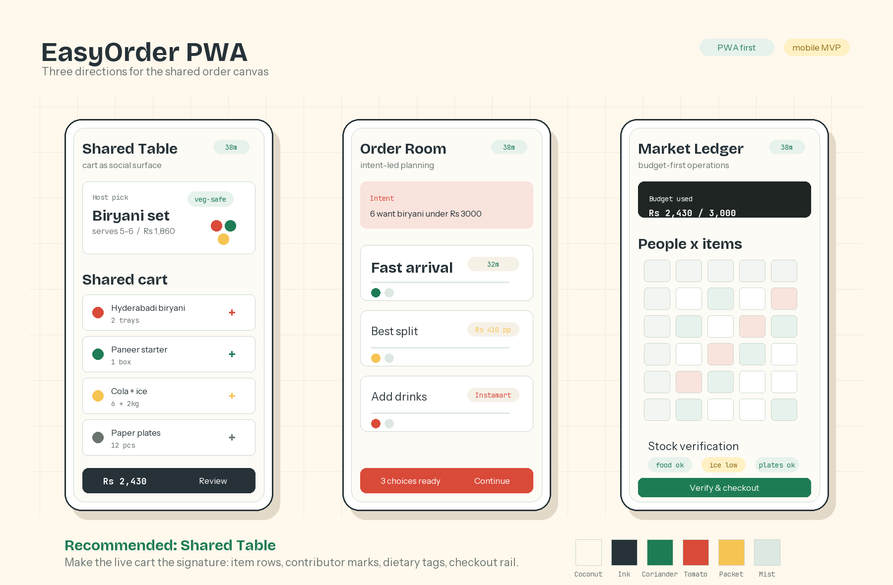

# EasyOrder PWA Design Directions

This document proposes three visual directions for the EasyOrder PWA. The goal is to decide what to build first for the collaborative cart experience before adding WhatsApp depth.

Visual board:



## Product Surface

The first PWA should help a group of 4-10 people open one shared session link, understand the recommended food plan, add personal preferences or Instamart supplies, and let the host complete checkout with confidence.

Primary audience:
- Party hosts coordinating food for friends or family.
- Guests joining from mobile phones with low patience and little context.
- Office/team organizers who need scanability and budget confidence.

Single job of the PWA:

> Make the shared order feel clear, live, and ready enough for the host to check out.

## Design Philosophy

The recommended visual philosophy is documented in [easyorder-pwa-visual-philosophy.md](./easyorder-pwa-visual-philosophy.md).

Short version: EasyOrder should feel like a shared table system. The cart is the table, guests orbit it, dietary and budget signals are visible, and checkout readiness is always grounded.

## Direction A: Shared Table

Best for the MVP.

This design makes the shared cart the center of the screen. Guest avatars and dietary tags sit close to the items they affect, so collaboration is visible without becoming a chat interface.

Core layout:

```text
┌─────────────────────────┐
│ EasyOrder   ETA 38 min  │
│ Session intent          │
├─────────────────────────┤
│ Host pick / bundle      │
│ Biryani, starters       │
│ guest chips nearby      │
├─────────────────────────┤
│ Shared cart             │
│ item rows + quantities  │
│ veg / spice / owner     │
├─────────────────────────┤
│ Add supplies  Checkout  │
└─────────────────────────┘
```

Why it works:
- It directly expresses the core product: one shared plan, many contributors.
- It keeps the host's decision burden visible and manageable.
- It scales from party orders to office lunches without changing the mental model.

Risks:
- If guest activity is overdone, the screen may feel noisy.
- Needs strong empty and loading states so first-time users know where to act.

Frontend-design review:
- This is the most subject-specific option. It does not look like a generic food delivery clone because the collaboration layer is visually primary.
- The signature element should be the "shared table stack": item rows with tiny contributor marks and dietary tags embedded into the cart, not floating social decoration.
- Keep motion restrained: a new guest addition can slide into the cart and briefly highlight the contributor chip.

## Direction B: Order Room

Best if WhatsApp conversation remains central.

This design presents the session as a room with three clear zones: group intent, recommendation canvas, and checkout tray. It feels more conversational than Direction A and could work well when the bot-generated prompt is a strong part of the experience.

Core layout:

```text
┌─────────────────────────┐
│ Intent summary          │
│ "6 people, biryani..."  │
├─────────────────────────┤
│ Recommended sets        │
│ cards / menus / swaps   │
├─────────────────────────┤
│ Live decisions          │
│ votes, notes, changes   │
├─────────────────────────┤
│ Total     Review order  │
└─────────────────────────┘
```

Why it works:
- Strong bridge from WhatsApp into PWA.
- Good for explaining AI recommendations and substitutions.
- Useful when the group starts with a rich natural-language prompt.

Risks:
- It can become too chat-like and bury the cart.
- It may feel less direct for users who just want to add drinks and leave.

Frontend-design review:
- Use this only if the product wants the AI assistant to feel present on-screen.
- Avoid long bot explanations. Use short recommendation labels like "fits budget", "arrives fastest", and "veg-safe".
- The aesthetic risk is a split between conversational context and operational cart controls; it needs discipline to avoid looking like a chatbot bolted onto a menu.

## Direction C: Market Ledger

Best for office or high-frequency coordinators.

This design treats the PWA as a compact ordering ledger. It prioritizes dense scanning, per-person budgets, item ownership, price changes, and readiness checks.

Core layout:

```text
┌─────────────────────────┐
│ Order status / budget   │
├─────────────────────────┤
│ People x Items matrix   │
│ dietary + payment cues  │
├─────────────────────────┤
│ Food / Supplies tabs    │
├─────────────────────────┤
│ Verify stock  Checkout  │
└─────────────────────────┘
```

Why it works:
- Excellent for B2B lunches and repeated operations.
- Makes budget and fairness obvious.
- Easier to audit before checkout.

Risks:
- Less warm for casual parties.
- Might feel heavy for the first MVP unless carefully simplified.

Frontend-design review:
- This is the most utilitarian option and should use tighter spacing, stronger tables, and fewer playful gestures.
- It should not use oversized hero typography or decorative cards. The value is in repeated use and fast comparison.
- Consider this as a later variant for office/team workflows.

## Recommended MVP Direction

Build **Direction A: Shared Table** first.

It best matches the PWA-first product strategy because it proves the unique value before WhatsApp integration: real-time group cart collaboration. It also gives the product a defensible visual identity. EasyOrder should not feel like another menu browser; it should feel like a live shared order surface.

## Token System

Color:
- `Coconut` `#FFF8EC` for the app surface.
- `Steel Ink` `#263238` for primary text.
- `Coriander` `#1E7C55` for availability, veg, and ready states.
- `Tomato` `#D94A38` for urgency and key food accents.
- `Packet Yellow` `#F6C453` for budget and active session highlights.
- `Cool Mist` `#DDE8E2` for dividers, rails, and quiet backgrounds.

Type:
- Display: `Bricolage Grotesque` or similar rounded grotesque for the EasyOrder wordmark, session title, and key totals.
- Body: `Instrument Sans` for menus, controls, and item rows.
- Utility: `JetBrains Mono` or similar for prices, ETAs, quantities, stock checks, and session tokens.

Shape and spacing:
- Keep cards at 8px radius or less.
- Use stable row heights for cart items so live updates do not jump.
- Prefer bottom sheets and segmented controls on mobile.
- Use avatar chips as state markers, not decoration.

Signature interaction:
- When a guest adds an item, the item joins the shared cart row with a small contributor mark, a short highlight, and an updated total. This moment is the product.

## First Screen Proposal

The first PWA screen should be a session dashboard, not a marketing page.

Above the fold:
- Session title generated from intent: "Biryani for 6".
- ETA, budget, and readiness indicators.
- Host recommendation bundle.
- Shared cart with visible guest contributions.
- Sticky bottom action rail: `Add food`, `Add supplies`, `Review checkout`.

Secondary screens:
- Add item/search modal.
- Dietary preference selector.
- Substitute item modal for stock issues.
- Host checkout review with Food and Instamart split clearly shown.

## Build Notes

Start with a mobile viewport around 390px wide. Desktop can become a two-column layout later: shared cart on the left, recommendation/supply browser on the right.

Use real-looking food content in mocks: biryani, starters, cold drinks, ice, plates, dessert. The interface needs to prove multi-vertical planning at a glance.

Avoid:
- Landing-page hero sections.
- Chatbot-first screens.
- Huge food photos that push the cart below the fold.
- Purple/blue SaaS gradients.
- Decorative cards inside cards.

## Decision Needed

Please review the three directions and choose one:

1. **Shared Table** for the PWA MVP.
2. **Order Room** if AI conversation should remain prominent.
3. **Market Ledger** if office/team lunch is the first serious target.
