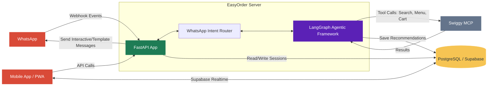
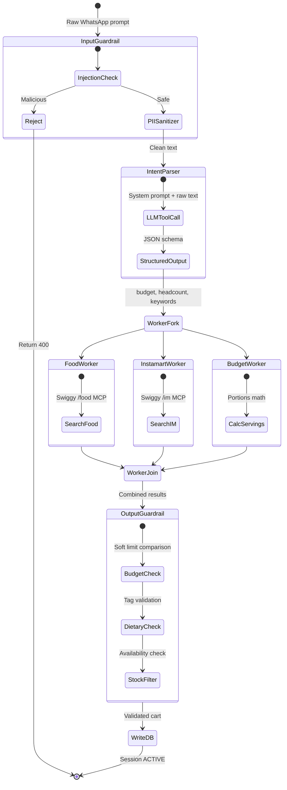

# High-Level Design (HLD) - EasyOrder Collaborative Concierge

This document specifies the system architecture for **EasyOrder**—a collaborative food and supply coordination service built using Python, FastAPI, LangGraph, PostgreSQL (Supabase), and the Swiggy Model Context Protocol (MCP).

The architecture is presented in three layers: a high-level overview showing all components and the request flow, followed by two detailed deep-dives — one for the FastAPI application setup and one for the Agentic AI framework.

---

## 1. High-Level System Architecture & Request Flow

The system is composed of five blocks: **WhatsApp** and **Mobile App (PWA)** as client ingress points on the left, the **EasyOrder Server** (containing the FastAPI application, intent router, and LangGraph Agentic Framework) in the center, **Swiggy MCP** as the external commerce platform on the right, and **PostgreSQL (Supabase)** as the persistence and real-time sync layer at the bottom.



### End-to-End Request → Response Lifecycle

| Step | What happens | Components involved |
|------|-------------|-------------------|
| 1 | After the group agrees on a menu, the host sends `@EasyOrder get biryani for 4, budget ₹2000` to the EasyOrder WhatsApp business/test number | WhatsApp → EasyOrder Server |
| 2 | FastAPI receives the webhook, validates Meta signature, and classifies the message as mention-triggered planning or dedicated business-chat assistance | FastAPI App → Intent Router |
| 3 | FastAPI creates a session ID and invokes the LangGraph agent with the raw prompt | FastAPI App → LangGraph |
| 4 | Agent runs Input Guardrails (prompt injection check, PII sanitization) | LangGraph Agentic Framework |
| 5 | Agent parses intent via LLM — extracts budget, headcount, dietary preferences | LangGraph → LLM (Gemini/GPT) |
| 6 | Agent concurrently queries Swiggy Food and Instamart via MCP tool calls | LangGraph → Swiggy MCP |
| 7 | Agent runs Output Guardrails (budget check, dietary validation, stock filter) | LangGraph Agentic Framework |
| 8 | Agent writes the session record, initiating message event, and recommended cart to PostgreSQL via Supabase | LangGraph → PostgreSQL (Supabase) |
| 9 | FastAPI replies privately to the host's WhatsApp `wa_id` with a CTA/template handoff or short-link fallback | FastAPI App → WhatsApp |
| 10 | The host opens the PWA; the session timeline shows the initiating WhatsApp message, EasyOrder activity, and cart events | Mobile App ↔ FastAPI/PostgreSQL |
| 11 | Host triggers checkout; FastAPI handles Swiggy OAuth and sequential cart creation | Mobile App → FastAPI App → Swiggy MCP |

### Dedicated Business Chat Lifecycle

The dedicated EasyOrder business chat reuses the same webhook and sender
infrastructure but follows a different intent path:

| Step | What happens | Components involved |
|------|-------------|-------------------|
| 1 | User opens the EasyOrder WhatsApp business account and sends `show monthly list`, `nearest best chole bhature`, or `what was my last order?` | WhatsApp → FastAPI |
| 2 | FastAPI validates the webhook and routes the message as dedicated business-chat mode | FastAPI → Intent Router |
| 3 | Intent Router classifies the request as saved list, discovery/offers, order history/status, share request, session planning, or unsupported | Intent Router |
| 4 | Supported commerce intents call LangGraph and Swiggy MCP; saved-list intents call persistence directly when deterministic parsing is enough | Intent Router → LangGraph/PostgreSQL/Swiggy MCP |
| 5 | EasyOrder replies in WhatsApp with a concise answer, CTA, or review link. It does not place orders without explicit review/checkout confirmation | FastAPI → WhatsApp |

---

## 2. Detailed Architecture A: FastAPI Application Setup

This section zooms into the FastAPI application gateway — its routing structure, database integration, authentication flows, and local development sandbox.

### 2.1 FastAPI Router Structure

```text
FastAPI Application (main.py)
├── GET  /api/whatsapp/webhook     → Webhook verification (Meta challenge-response)
├── POST /api/whatsapp/webhook     → Message ingestion, mode classification, intent routing, agent invocation
├── GET  /api/session/{session_id} → Tokenized session bootstrap with redacted activity timeline
├── POST /api/session/{session_id}/cart-items → Session-scoped cart mutations
├── POST /api/session/checkout     → Pre-checkout stock/price validation
├── POST /api/session/checkout/confirm → Swiggy OAuth code exchange + cart creation
├── GET/POST /api/lists            → Saved list management
├── POST /api/lists/{list_id}/convert → Convert saved list to reviewable session/cart
└── Middleware: CORS, Rate Limiting, Request Logging
```

### 2.2 PostgreSQL Real-time Sync (Supabase Realtime)
* **Direct Client Sync:** PWA clients use the Supabase JS SDK to subscribe to `postgres_changes` channels on the `cart_items` table. Inserts, updates, and deletes broadcast instantly to all connected devices via WebSocket.
* **Backend Writes:** The FastAPI backend (and the LangGraph agent) write to PostgreSQL via the `supabase-py` SDK (service role key) for session initialization and status updates. LangGraph also uses `langgraph-checkpoint-postgres` for native agent state persistence.
* **Row Level Security (RLS):** PostgreSQL RLS policies enforce that guests can only modify rows in `cart_items` where `session_id` matches their token, while session metadata (budget, status, address) is restricted to the host token.

### 2.3 Swiggy OAuth Checkout Handoff
1. PWA triggers a pre-checkout validation via `POST /api/session/checkout` — the backend verifies stock and pricing against Swiggy MCP.
2. On success, the PWA redirects the host to Swiggy's OAuth portal.
3. Swiggy redirects back with an authorization code.
4. PWA sends the code to `POST /api/session/checkout/confirm` — the backend exchanges it for an access token, creates one checkout payload per Food restaurant plus a separate Instamart payload when needed, and returns the ordered checkout redirect URLs.

### 2.4 Authentication & Token Separation
* **Host Token:** SHA-256 derived, sent privately to the initiating WhatsApp `wa_id`. Grants full session control and checkout privileges.
* **Guest Token:** Random UUID, sent to the host as a shareable planning link. Grants cart item read/write only.
* **WhatsApp User Identity:** Initially keyed by sender `wa_id` for sandbox/local use. Production identity must account for verified business contact, consent, and any Swiggy OAuth user link before exposing order history or saved lists.
* **Supabase Auth:** PWA clients authenticate via Supabase Anonymous Auth (or magic link). The JWT is passed in API headers and evaluated by RLS policies on every database operation.

### 2.5 WhatsApp Message Timeline And Handoff
* **Session Events:** The backend stores redacted timeline events for inbound
  WhatsApp messages, EasyOrder handoff attempts, cart mutations, checkout
  validation, and checkout confirmation.
* **User-Facing Timeline:** The PWA renders these events so the host can see that
  the phone message and the session canvas match.
* **CTA Handoff:** Meta mode should use supported interactive/template messages
  for `Review order` / `Open EasyOrder` when configured. If not available,
  EasyOrder sends short branded links instead of long raw token URLs.
* **Token Privacy:** Host tokens may exist inside signed/redirect URLs, but raw
  token values must not appear in webhook responses, guest timelines, or share
  summaries.

### 2.6 Local Development & Free-Tier Sandbox
* **WhatsApp Sandbox:** Meta's free developer sandbox supports 5 pre-registered test numbers at no cost.
* **Webhook Tunneling:** `npx localtunnel --port 8000` or `ngrok http 8000` to expose the local FastAPI server to Meta's HTTPS webhook requirements.
* **Local PostgreSQL:** `docker compose up db` starts PostgreSQL locally. No cloud account required. Supabase CLI (`npx supabase start`) optionally provides the full Supabase stack (Auth, Realtime, Storage) locally.
* **Mock Swiggy MCP:** A local mock client returns static restaurant/item data, with configurable latency to test timeout degradation.

---

## 3. Detailed Architecture B: Agentic AI Framework (LangGraph, Guardrails & Harness)

This section zooms into the LangGraph-based AI system — its state machine, node structure, prompt harness, safety guardrails, and degradation policies.

### 3.1 LangGraph State Machine Overview

The agent is a deterministic state graph. Each node performs one task and mutates a shared typed state dictionary. The flow is: sanitize → parse → search (parallel) → validate → persist.



### 3.2 Agent Node Responsibilities

| Node | Input | Output | What it does |
|------|-------|--------|-------------|
| **Input Guardrail** | Raw prompt string | Sanitized string or rejection | Blocks prompt injections; masks emails, phone numbers, card numbers |
| **Intent Parser** | Sanitized text | `{budget, headcount, food_keywords, grocery_keywords, dietary_preference}` | LLM tool-call extracts structured constraints from natural language |
| **Food Worker** | lat, lng, food_keywords | List of restaurant/menu results | Queries Swiggy Food MCP (`searchRestaurants`, `getRestaurantMenu`) |
| **Instamart Worker** | lat, lng, grocery_keywords | List of grocery/supply items | Queries Swiggy Instamart MCP (`searchInstamart`) |
| **Budget Worker** | headcount, food_results, im_results | Serving estimates, cost totals | Calculates portion sizes and total cost |
| **Output Guardrail** | Combined results + constraints | Validated cart + warnings | Budget soft-check, dietary tag validation, mock-item filtering |
| **Write DB** | Validated state | Session status = ACTIVE | Persists session record and cart items to PostgreSQL via Supabase |

### 3.3 Cart Source Attribution And Checkout Grouping

Every cart item persisted by the agent or added manually through the PWA must carry
source attribution:

* Food items include `restaurant_id` and `restaurant_name`.
* Instamart items include `brand_name` when available and a store/source label when available.
* The PWA renders this source on every cart row and in checkout previews.

Food checkout payloads are grouped by `restaurant_id` because Swiggy Food does not
support one order spanning multiple restaurants. A consolidated EasyOrder session can
therefore produce multiple Food checkout steps plus one Instamart step. The agent should
prefer single-restaurant Food recommendations when they satisfy the group's prompt,
budget, and dietary constraints.

### 3.4 Prompt Harness & LLM Strategy

* **Intent Parser System Prompt:** Instructs the LLM to output a strict JSON schema with budget, headcount, food/grocery keywords, and dietary preference. Provides defaults (budget=3000, headcount=4) for missing fields.
* **LLM Model Ladder:**
  - **Local Dev:** Ollama (Llama 3.1 8B) — free, runs in Docker, sufficient for testing prompt schemas.
  - **Staging:** Google AI Studio free tier (Gemini 1.5 Flash) — free, massive context window for full menu dumps.
  - **Production:** GPT-4o mini — lowest latency, strongest JSON/tool-calling reliability.

### 3.5 Safety Guardrails

#### Input Guardrails (Pre-LLM)
* **Prompt Injection Detection:** Regex-based pattern matching for override attempts like `"ignore previous instructions"`, `"system prompt bypass"`, etc. Blocks and returns HTTP 400.
* **PII Sanitization:** Masks email addresses, credit card numbers, and phone numbers before the text reaches the LLM.

#### Output Guardrails (Post-LLM, Pre-Persist)
* **Soft Budget Enforcement:** If the recommended cart total exceeds the host's budget, the agent does NOT reject the session. Instead, it writes a `budget_warning` flag to the session record in PostgreSQL. The PWA displays a warning badge, letting collaborators trim items themselves.
* **Dietary Integrity Check:** Validates that items in a VEG-tagged session are actually tagged VEG. Non-matching items trigger a warning.
* **Mock/Placeholder Filter:** Strips items with names containing "mock" or "placeholder" to prevent test data from leaking into production sessions.

### 3.6 Degradation & Timeout Policies

* **2.5-Second Execution SLA:** All concurrent worker searches run inside `asyncio.wait_for(..., timeout=2.5)`. If any vertical times out, the agent proceeds with partial results.
* **Degraded State Flag:** When a vertical fails, the session is initialized with `status: "DEGRADED"` and a human-readable warning (e.g., *"Cold drinks search timed out. You can add items manually on the canvas."*). The PWA renders the available results immediately without blocking.
* **No Autonomous Ordering:** The agent can never place an order or charge a card. It only recommends items and compiles carts. Actual payment requires explicit host action via Swiggy's checkout page.
