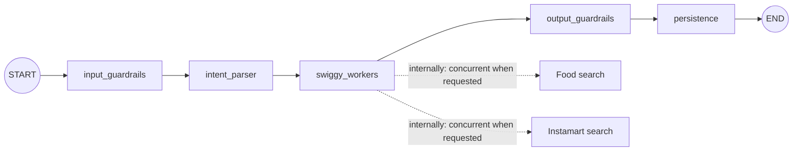
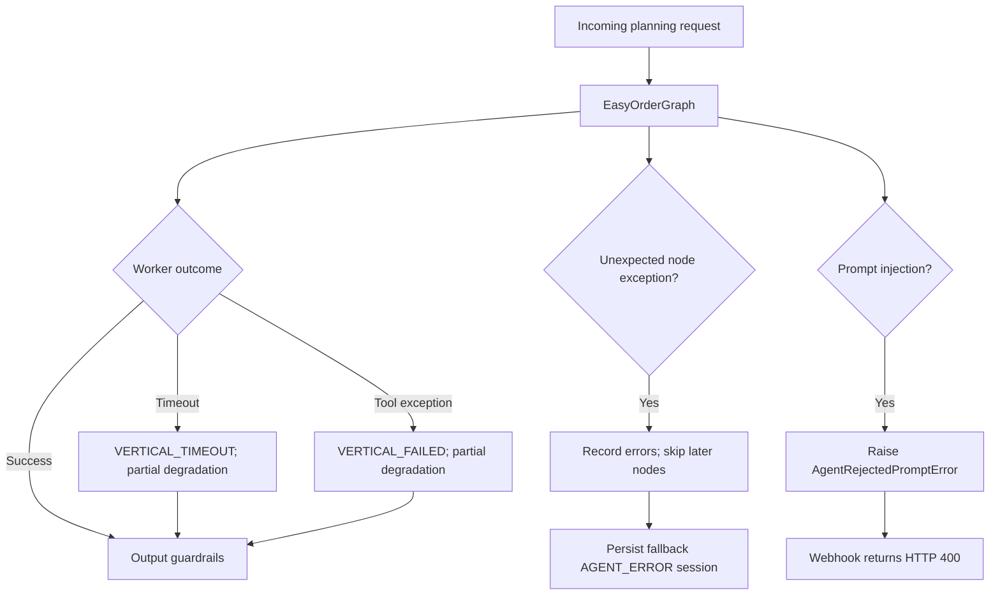
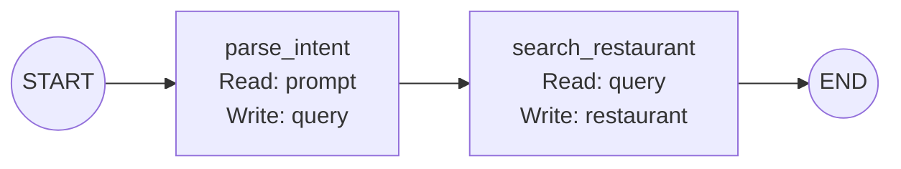
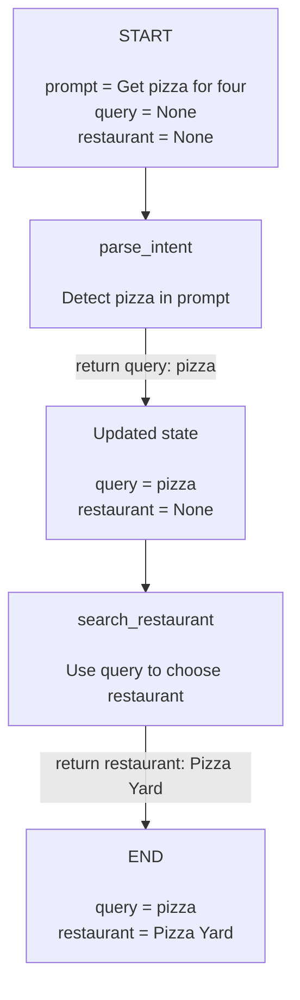
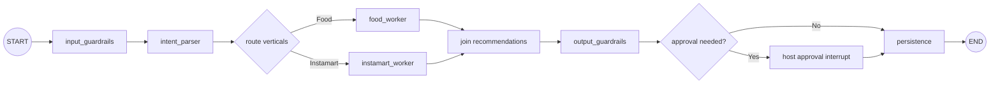

# LangGraph Tutorial Using EasyOrderGraph

## Why this tutorial exists

This tutorial explains LangGraph through the real `EasyOrderGraph` implementation.
It starts with the simplest mental model, walks through every graph node and major
runtime scenario, and then evaluates the design at Principal AI Architect depth.

The repository currently pins `langgraph==1.2.6`.

## LangGraph in one minute

LangGraph is a low-level orchestration framework for building stateful workflows
and agents. A graph has three core concepts:

- **State**: the shared data that evolves during one run.
- **Nodes**: Python functions that read and update state.
- **Edges**: transitions that decide which node executes next.

The shortest useful summary is:

```text
State = what the workflow knows
Node  = work performed at one step
Edge  = where execution goes next
```

Nodes do not have to call an LLM. They can validate input, call an API, run
ordinary business logic, persist data, or request human approval. A workflow has
predetermined paths; an agent dynamically decides its process and tool use.
EasyOrder is currently much closer to a **deterministic workflow** than an
autonomous agent.

Official references:

- [LangGraph overview](https://docs.langchain.com/oss/python/langgraph/overview)
- [Graph API](https://docs.langchain.com/oss/python/langgraph/graph-api)
- [Workflows and agents](https://docs.langchain.com/oss/python/langgraph/workflows-agents)

## What EasyOrderGraph looks like



The graph is assembled from five named node functions:

```python
def build_graph(self) -> EasyOrderGraph:
    return EasyOrderGraph(
        [
            ("input_guardrails", self.apply_input_guardrails),
            ("intent_parser", self.parse_intent),
            ("swiggy_workers", self.run_workers),
            ("output_guardrails", self.apply_output_guardrails),
            ("persistence", self.persist_session),
        ]
    )
```

`EasyOrderGraph.compile()` translates that list into a LangGraph `StateGraph`:

1. Create `StateGraph(EasyOrderState)`.
2. Add every named node.
3. Set the first node as the entry point.
4. Add a fixed edge between each adjacent pair.
5. Connect the last node to `END`.
6. Compile the graph before invocation.

This produces a sequence, not routing, loops, or graph-level fan-out.

## The shared state

EasyOrder uses a Python dataclass as its state schema:

```python
@dataclass
class EasyOrderState:
    message: IncomingMessage
    sanitized_prompt: str | None = None
    intent: ParsedIntent | None = None
    food_results: list[dict[str, Any]] = field(default_factory=list)
    instamart_results: list[dict[str, Any]] = field(default_factory=list)
    degraded_verticals: list[Vertical] = field(default_factory=list)
    warnings: list[SessionWarning] = field(default_factory=list)
    cart_items: list[CartItem] = field(default_factory=list)
    budget_warning: bool = False
    session: Session | None = None
    host_token: str | None = None
    status: SessionStatus = SessionStatus.INITIALIZING
    errors: list[str] = field(default_factory=list)
```

Think of state as a folder passed from desk to desk:

| State field | Written by | Why it exists |
| --- | --- | --- |
| `message` | Initial caller | Original flattened WhatsApp message |
| `sanitized_prompt` | Input guardrails | Safe text for downstream parsing |
| `intent` | Intent parser | Budget, head count, dietary preference, and queries |
| `food_results` | Swiggy workers | Food MCP/mock results |
| `instamart_results` | Swiggy workers | Instamart MCP/mock results |
| `degraded_verticals` | Swiggy workers | Verticals that failed or timed out |
| `warnings` | Workers and output guardrails | Recoverable user-visible conditions |
| `cart_items` | Output guardrails | Valid starter recommendations |
| `budget_warning` | Output guardrails | Whether seeded quantities exceed the budget |
| `status` | Output guardrails or error wrapper | `INITIALIZING`, `ACTIVE`, or `DEGRADED` |
| `session` | Persistence | Persisted EasyOrder session |
| `host_token` | Persistence/fallback | Private host credential returned outside the session |
| `errors` | Graph node wrapper | Unexpected node failures |

EasyOrder nodes mutate and return the same state object. LangGraph also supports
the more idiomatic pattern where nodes return partial dictionaries such as
`{"intent": parsed_intent}` and reducers merge concurrent updates.

## One complete successful run

Use this message as the running example:

```text
@EasyOrder get vegetarian pizza and drinks for 4 under 3000
```

### Initial invocation

The WhatsApp route creates an `IncomingMessage` and calls:

```python
result = await agent_service.initialize_tagged_message(message)
```

The service creates initial graph state:

```python
EasyOrderState(message=message)
```

All other fields start empty, false, `None`, or `INITIALIZING`.

### Node 1: `input_guardrails`

This node:

1. Searches for prompt-injection phrases such as `ignore previous instructions`,
   `system prompt`, `developer message`, and `jailbreak`.
2. Rejects the request if one is found.
3. Redacts email addresses, Indian phone numbers, and likely card numbers.
4. Stores the cleaned value in `state.sanitized_prompt`.

State after the happy path:

```text
sanitized_prompt = "@EasyOrder get vegetarian pizza and drinks for 4 under 3000"
```

### Node 2: `intent_parser`

The local `MockIntentParser` is deterministic; it is not an LLM. It extracts:

```text
budget_limit       = 3000.00
head_count         = 4
dietary_preference = VEG
food_query         = "vegetarian pizza drinks"
instamart_query    = "drinks"
```

The parser defaults to a budget of INR 3000 and four people when those values
are absent. Head count is clamped to the range 1–100.

Architectural observation: the parser's Food query currently retains words such
as `vegetarian` and `drinks`, even though `drinks` also becomes the Instamart
query. The deterministic mock still finds pizza because it uses substring
matching, but a production search adapter may benefit from a more precise query
schema per vertical.

### Node 3: `swiggy_workers`

Food search is always started. Instamart search is started only when
`instamart_query` is not `None`.

```python
food_result, instamart_result = await asyncio.gather(
    food_task,
    instamart_task,
)
```

For this example:

- Food search matches `pizza` and returns pizza and brownie results.
- Instamart search uses the default drinks branch and returns cola and water.
- `_starter_recommendations` later selects only the first usable result from
  each vertical.

Each worker has a 2.5-second default timeout. A worker converts timeout or tool
failure into a warning instead of raising it through the graph.

Important distinction: Food and Instamart are **not separate LangGraph nodes**.
They are coroutines executed concurrently inside the single `swiggy_workers`
node. Therefore LangGraph cannot independently checkpoint, retry, trace, or
resume them as graph steps.

### Node 4: `output_guardrails`

This node turns raw recommendations into a safe starter cart:

1. Remove placeholder results whose names contain `mock` or `placeholder`.
2. Keep at most the first usable result from each requested vertical.
3. Require Food items to have restaurant ID and name.
4. Require Instamart items to have a source label.
5. Convert dictionaries into typed `CartItem` models.
6. Set Food quantity to head count.
7. Set Instamart quantity to roughly one unit per two people.
8. Calculate whether the cart exceeds the budget.
9. Add a dietary mismatch warning when needed.
10. Set status to `DEGRADED` if a vertical degraded; otherwise set `ACTIVE`.

Warnings do not all affect status in the same way. A worker timeout makes the
session degraded. Budget, dietary, and source-attribution warnings alone do not.

### Node 5: `persistence`

The final node:

1. Generates host and guest tokens.
2. Builds a `SessionCreate` model from intent, status, and warnings.
3. Hashes the host token before database storage.
4. Persists session metadata and cart items atomically through `IDBAdapter`.
5. Places the persisted session and raw private host token in graph state.

The graph reaches `END`. `initialize_tagged_message` returns only:

```python
SessionInitResult(session=final_state.session, host_token=final_state.host_token)
```

## Scenario catalogue

### Scenario 1: Food-only request

Example:

```text
@EasyOrder get biryani for 4 under 2000
```

Flow:

```text
guardrails -> parsing -> Food search only -> cart checks -> persistence
```

`instamart_query` is `None`, so no Instamart coroutine is created. The session
is `ACTIVE`, contains only Food, and has no degraded vertical.

### Scenario 2: Food and Instamart both succeed

Example:

```text
@EasyOrder get biryani and drinks for 4 under 3000
```

Both searches execute concurrently inside `swiggy_workers`. One Food item and
one Instamart item seed the cart. The session becomes `ACTIVE`.

### Scenario 3: One vertical times out

If Instamart exceeds the worker timeout:

```text
food_results            = successful Food results
instamart_results       = []
degraded_verticals      = [INSTAMART]
warnings                += VERTICAL_TIMEOUT
status                  = DEGRADED
cart                    = Food items only
```

This is graceful partial degradation: useful results survive even when one
dependency misses its latency budget.

### Scenario 4: All verticals time out

Both result lists become empty. Both verticals are marked degraded, two timeout
warnings are recorded, and an empty degraded session is still persisted. The
user can add items manually rather than losing the planning session entirely.

### Scenario 5: A worker raises an exception

`_run_worker` converts ordinary worker exceptions to `VERTICAL_FAILED`, records
the exception class in the message, and returns no results for that vertical.
The behavior otherwise matches a timeout: other verticals can succeed and the
session is persisted as degraded.

### Scenario 6: Mock search returns no results

An empty list is a successful response, not an exception. No vertical warning
is added, so the current logic can persist an `ACTIVE` session with no item from
that vertical. This is a product-policy decision worth making explicit: “no
matches” is semantically different from “dependency unavailable,” but an active
empty session may still need a user-facing `NO_RESULTS` warning.

### Scenario 7: Item lacks source attribution

A Food item without restaurant ID/name, or an Instamart item without source
label, is skipped. A `SOURCE_ATTRIBUTION_MISSING` warning is added. This protects
checkout grouping and traceability.

Current behavior does not mark the session degraded solely for this warning.

### Scenario 8: Cart exceeds budget

Quantities are assigned before total calculation. When total exceeds the parsed
budget:

- `budget_warning=True`
- warning code `BUDGET_EXCEEDED` is appended
- the cart remains intact
- session status remains `ACTIVE` unless a vertical also degraded

This is advisory policy, not a hard constraint solver.

### Scenario 9: Dietary mismatch

For a vegetarian intent, any selected non-vegetarian item produces a
`DIETARY_MISMATCH` warning. The item is not removed and status is not changed.
This is also advisory rather than enforcement.

### Scenario 10: Prompt injection is detected

`AgentRejectedPromptError` is intentionally re-raised by the graph wrapper. It
does not become a degraded session. The WhatsApp API maps it to HTTP `400` with
the message that the tagged prompt failed input guardrails.

This separates a rejected request from an operational failure.

### Scenario 11: An unexpected graph node fails

Every node is wrapped by `_wrap_node`. For exceptions other than
`AgentRejectedPromptError`, the wrapper:

```text
errors += "<node_name>: <ExceptionClass>"
status = DEGRADED
```

Every later wrapped node sees `state.errors` and becomes a no-op. After graph
completion, `initialize_tagged_message` sees that no normal session exists and
calls `persist_error_session`. The fallback session has an `AGENT_ERROR` warning
and preserves whatever cart items existed before the failure.

Example: if intent parsing raises `RuntimeError`, workers, output guardrails,
and normal persistence are skipped. A degraded, empty fallback session is saved.

### Scenario 12: Normal persistence fails

If `persist_session` fails, the node wrapper records a persistence error and the
graph ends without a session. The service then calls `persist_error_session`.

If the original failure was caused by malformed session construction, fallback
persistence may succeed. If the database itself is unavailable, the fallback
uses the same database dependency and will likely fail too. A durable production
design therefore needs retry/idempotency and an external failure path; fallback
logic alone is not database resilience.

### Scenario 13: Duplicate WhatsApp webhook

Duplicate detection happens before LangGraph. The webhook route checks whether
the WhatsApp message ID already has a processed event. If so, it does not invoke
the graph again. This protects side effects from Meta delivery retries.

### Scenario 14: WhatsApp handoff fails after graph success

The graph may successfully persist a session while outbound WhatsApp delivery
fails. This is outside the graph. The API records `HANDOFF_FAILED` and returns
HTTP `502`, allowing the provider retry path to attempt delivery again.

This illustrates a crucial system boundary: graph success does not equal
end-to-end business success.

## How error handling is layered



The three policies are:

1. **Expected dependency failure**: degrade one vertical and continue.
2. **Unexpected workflow failure**: stop meaningful node work and persist a
   degraded fallback session.
3. **Safety rejection**: abort and return a client error; do not create a
   session.

## LangGraph concepts present in EasyOrder

| LangGraph concept | EasyOrder implementation |
| --- | --- |
| State schema | `EasyOrderState` dataclass |
| Node | Bound async methods such as `parse_intent` |
| Static edge | Fixed transitions between adjacent node names |
| Entry point | `input_guardrails` |
| Terminal edge | `persistence -> END` |
| Compilation | `StateGraph.compile()` inside `EasyOrderGraph.compile()` |
| Async invocation | `_compiled.ainvoke(state)` |
| Parallel work | `asyncio.gather` inside one node, not graph fan-out |
| Error policy | Custom wrapper plus worker-specific recovery |

## Important LangGraph capabilities not currently used

### Conditional routing

EasyOrder has no `add_conditional_edges`. Every normal run traverses all five
nodes. Conditional edges could explicitly represent routes such as Food-only,
Food-plus-Instamart, manual review, or early termination.

### Graph-level parallel branches

LangGraph can fan out to multiple nodes in the same super-step and join their
state updates. EasyOrder instead performs concurrency inside `swiggy_workers`.
Graph-level branches would improve per-vertical observability and retry control,
but require carefully defined reducers for concurrently updated lists.

### Checkpointing and threads

The graph compiles without a checkpointer. Therefore LangGraph itself does not
persist state after each node and cannot resume at the last graph checkpoint.
EasyOrder's database persistence is business persistence at the final node; it
is not LangGraph checkpoint persistence.

With a checkpointer and `thread_id`, LangGraph can support durable state,
replay, time-travel debugging, fault recovery, and human-in-the-loop flows.
See [LangGraph persistence](https://docs.langchain.com/oss/python/langgraph/persistence).

### Interrupts and human approval

No graph node pauses for a host decision. LangGraph interrupts could pause
before checkout or after a budget/dietary warning, persist state, and resume
after approval. See [LangGraph interrupts](https://docs.langchain.com/oss/python/langgraph/interrupts).

### Loops

The graph has no refinement loop. A future workflow could revise recommendations
until constraints pass, but it would need an explicit iteration limit to prevent
unbounded cost or latency.

### Streaming

EasyOrder uses `ainvoke`, which waits for the graph result. Streaming graph
updates could expose progress such as “parsing request,” “searching Food,” and
“building cart” to a UI or observability pipeline.

### Retry and cache policies

Retries are not defined as node policies, and no node cache is configured.
Production commerce lookups require deliberate retry rules: retry transient
transport errors, avoid retrying validation errors, add jitter, and respect the
end-to-end latency budget.

## A minimal LangGraph version of the EasyOrder sequence

This standalone example shows the basic mechanics without application details:

```python
from dataclasses import dataclass
from langgraph.graph import END, START, StateGraph


@dataclass
class OrderState:
    prompt: str
    query: str | None = None
    restaurant: str | None = None


def parse_intent(state: OrderState) -> dict:
    query = "pizza" if "pizza" in state.prompt.lower() else "food"
    return {"query": query}


def search_restaurant(state: OrderState) -> dict:
    restaurant = "Pizza Yard" if state.query == "pizza" else "Biryani House"
    return {"restaurant": restaurant}


builder = StateGraph(OrderState)
builder.add_node("parse_intent", parse_intent)
builder.add_node("search_restaurant", search_restaurant)
builder.add_edge(START, "parse_intent")
builder.add_edge("parse_intent", "search_restaurant")
builder.add_edge("search_restaurant", END)

graph = builder.compile()
result = graph.invoke(OrderState(prompt="Get pizza for four"))
```

The graph topology created by those `add_node` and `add_edge` calls is:



The same diagram with state snapshots makes the data flow explicit:



What happens:

```text
initial state
  -> parse_intent returns query="pizza"
  -> search_restaurant reads query and returns restaurant="Pizza Yard"
  -> END returns final state
```

## What graph-level parallelism could look like

Conceptually, a more graph-native EasyOrder topology would be:



This is not the current implementation. It is an architectural evolution that
would make routing, fan-out, joining, and approval explicit in graph topology.

## Principal AI Architect analysis

### 1. Is this really an “agent”?

A strong answer is:

> EasyOrder currently uses LangGraph as a deterministic workflow orchestrator.
> The route and tool sequence are predefined; the model does not dynamically
> choose tools or decide when it is finished. That is appropriate where ordering,
> money, safety, and side effects require predictable control.

Do not equate “uses LangGraph” with “is autonomous.” Framework choice and
autonomy level are separate design decisions.

### 2. Why use a graph for a linear workflow?

Good reasons:

- Stable named stages and a common state contract
- A natural path toward routing, parallelism, approvals, and replay
- Consistent instrumentation boundaries
- Testable node-level policies

Reasons to challenge it:

- Five sequential functions could be ordinary application code
- The custom wrapper hides some native LangGraph capabilities
- Without checkpointing, conditional edges, graph fan-out, or streaming, the
  operational value over a plain pipeline is currently modest

The architect's job is not to defend the framework. It is to show that current
complexity is proportional to requirements and that the evolution path is real.

### 3. Determinism versus autonomy

Keep deterministic code for:

- Authentication and authorization
- Budget arithmetic
- Source-attribution validation
- Token generation and storage
- Idempotency and persistence
- Checkout side effects

Use LLM reasoning where ambiguity is valuable:

- Intent interpretation
- Constraint extraction with structured output
- Recommendation explanation
- Substitute ranking

Bound every probabilistic step with schemas, timeouts, fallbacks, and policy
validation.

### 4. State ownership and data classification

Not every value belongs in durable graph state. Classify fields as:

| Class | Examples | Design treatment |
| --- | --- | --- |
| User input | Message text, dietary preference | Minimize, redact, retain by policy |
| Derived state | Parsed intent, warnings | Version schemas and record provenance |
| External data | Swiggy results and prices | Timestamp, identify source, handle staleness |
| Secrets | Raw host token, OAuth authorization | Avoid checkpoints/logs; encrypt or keep out of graph state |
| Side-effect identity | Message ID, session ID | Use for idempotency and audit |

If LangGraph checkpointing is added, `host_token` deserves special scrutiny:
checkpointing the entire state could persist raw secret material.

### 5. Reliability and idempotency

Ask of every node:

- Can it safely run twice?
- What is the idempotency key?
- Is the side effect committed before or after checkpointing?
- What happens if execution crashes after the side effect but before state is
  recorded?

For EasyOrder, the WhatsApp message ID is the natural run-level idempotency key.
Database creation and outbound handoff should have explicit idempotency semantics
if graph replay or automatic retries are introduced.

### 6. Latency budgets

EasyOrder gives workers 2.5 seconds, but architecture should define an
end-to-end budget:

```text
webhook validation
+ intent parsing
+ external searches
+ guardrails
+ database commit
+ outbound handoff
<= provider/user experience deadline
```

Parallelism reduces the critical path only when tasks are independent. Retries
consume the same budget and should be conditional on remaining time.

### 7. Observability

At minimum, record per node and external call:

- Run/request/message/session identifiers
- Node name and attempt number
- Start/end time and latency
- Input/output schema versions, not raw sensitive payloads
- Tool name, response size, and normalized error category
- Token/model/cost metrics for LLM nodes
- Warnings, degraded verticals, and final business outcome

Distinguish technical success from business success. A graph can finish while
the cart is empty or the WhatsApp handoff fails.

### 8. Evaluation strategy

Evaluate layers separately:

| Layer | Example metrics/tests |
| --- | --- |
| Intent parser | Field accuracy, constraint recall, adversarial prompts |
| Retrieval/tools | Availability, latency, freshness, source completeness |
| Recommendation policy | Budget adherence, dietary compliance, diversity |
| Workflow | Route correctness, timeout degradation, idempotency |
| End-to-end | Session created, links delivered, checkout conversion |

Use deterministic fixtures for workflow correctness, recorded MCP contracts for
adapter compatibility, and curated/production-like datasets for LLM quality.

### 9. Security and governance

Key concerns include:

- Prompt injection crossing into tool calls
- PII in prompts, traces, and checkpoints
- OAuth/token exposure
- Over-broad commerce tool permissions
- Unauthorized or accidental cart/order actions
- Data retention and deletion
- Auditability of automated decisions

Apply least privilege, explicit user confirmation before consequential actions,
schema validation on tool outputs, secret redaction, and immutable audit events.

### 10. Versioning and change management

Version the graph topology, state schema, prompts, model, tool contracts, and
policy rules. A changed node name or state type matters if durable checkpoints
exist. Rollouts should support replay tests, canaries, rollback, and comparison
of business and safety metrics.

## Interview questions and concise answers

### Why LangGraph instead of a simple chain?

Use LangGraph when explicit state, branching, parallel steps, durable execution,
human approval, or replay are real requirements. EasyOrder currently gains named
stages and an evolution path, though its present topology remains a simple chain.

### Where is parallelism in EasyOrder?

Inside `swiggy_workers` through `asyncio.gather`. It is coroutine-level
parallelism, not LangGraph node-level fan-out.

### What happens when Instamart fails but Food succeeds?

The worker converts failure into a vertical warning, preserves Food results,
marks Instamart degraded, builds a Food-only cart, and persists a degraded
session.

### How would you add human approval?

Add a decision node after cart validation, compile with a durable checkpointer,
call `interrupt()` when approval is required, and resume using `Command` with a
stable thread ID. Ensure all pre-interrupt side effects are idempotent.

### What is the difference between database persistence and a checkpointer?

The database stores EasyOrder's business entity. A LangGraph checkpointer stores
workflow execution snapshots so a run can resume, replay, or pause. They solve
different problems and may both be required.

### What would you change first for production maturity?

1. Define end-to-end SLIs and trace each node/tool call.
2. Add explicit error taxonomy and idempotency contracts.
3. Separate Food and Instamart into graph nodes if independent retry/resume is
   operationally valuable.
4. Add checkpointing only after removing secrets from checkpointed state.
5. Add a host approval interrupt before consequential checkout actions.
6. Evaluate the parser and recommendation policy with versioned datasets.

### How do you prevent runaway agent behavior?

Prefer deterministic topology for consequential actions, use allowlisted tools,
validate structured inputs/outputs, cap iterations and cost, enforce timeouts,
require approval for side effects, and make every retry/replay idempotent.

## Practical exercises

1. **Trace state:** Print a sanitized state summary after each current node.
2. **Add a route:** Skip the Swiggy node when no commerce intent exists.
3. **Split workers:** Implement Food and Instamart as parallel graph nodes with
   reducers and a join.
4. **Add `NO_RESULTS`:** Distinguish successful empty search from dependency
   failure.
5. **Add approval:** Pause when budget or dietary warnings exist.
6. **Add checkpointing:** Use a non-production checkpointer and a `thread_id`,
   while removing the raw host token from persisted graph state.
7. **Test replay:** Prove session creation and handoff remain idempotent.
8. **Create an evaluation set:** Cover parser ambiguity, injection, budgets,
   dietary constraints, mixed verticals, timeouts, and malformed MCP responses.

## Source map

- `src/backend/app/services/agent.py` — state, graph wrapper, nodes, and policies.
- `src/backend/app/services/mock_agent.py` — mock-mode dependency composition.
- `src/backend/app/services/mock_swiggy.py` — deterministic worker dependency.
- `src/backend/app/services/protocols.py` — database and MCP contracts.
- `src/backend/app/api/whatsapp.py` — request ingress and post-graph handoff.
- `src/backend/tests/test_agent_service.py` — graph and degradation scenarios.
- `src/backend/requirements.txt` — pinned LangGraph version.
