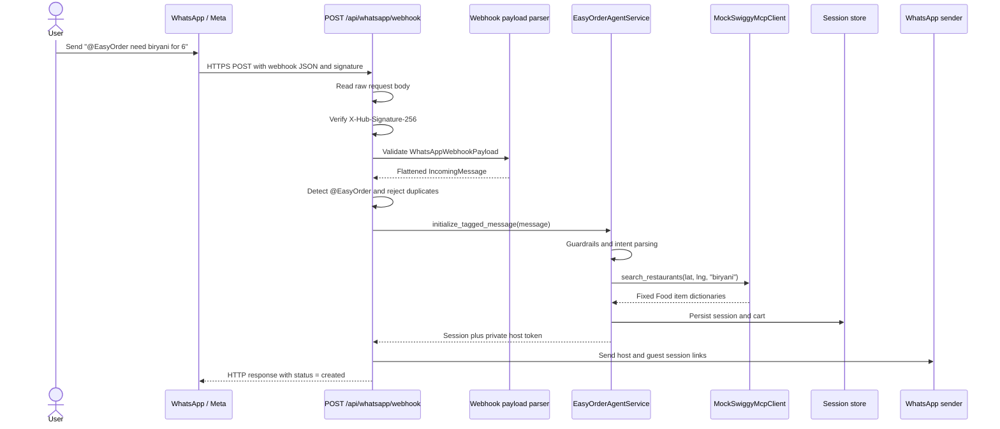
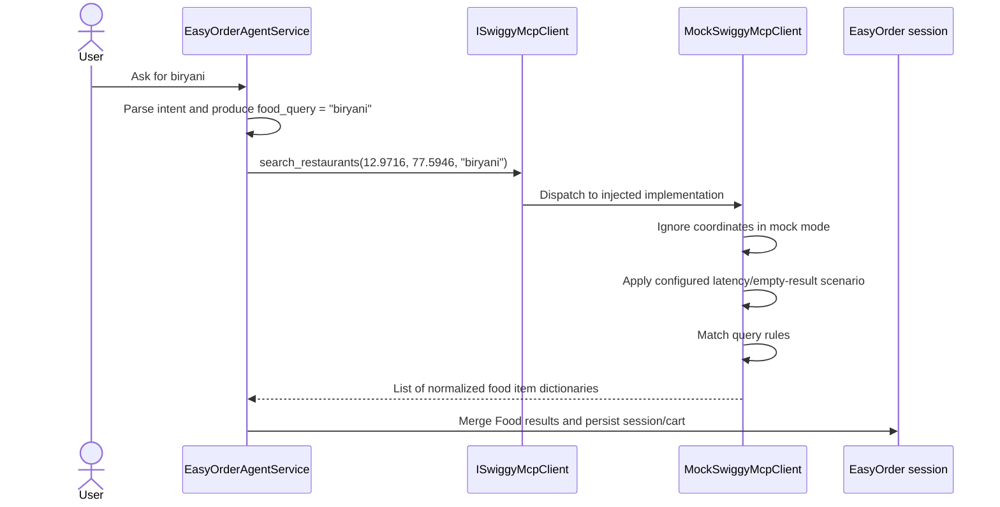
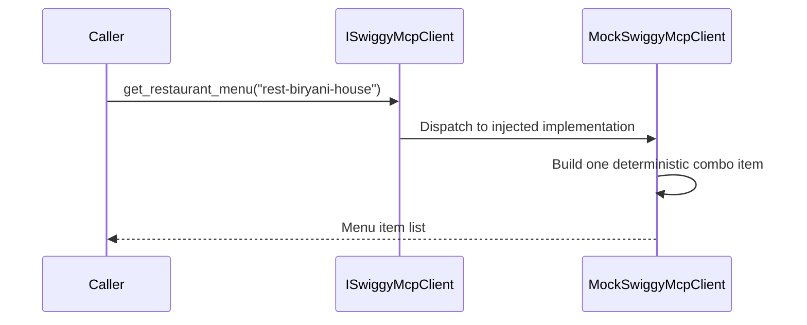

# Mock Swiggy Restaurant Call Flow

## Purpose

This document explains how EasyOrder receives restaurant information from the
local `MockSwiggyMcpClient`. It covers two use cases:

1. Searching for restaurants or dishes with `search_restaurants`.
2. Fetching a restaurant menu with `get_restaurant_menu`.

The mock client is an in-process Python object. It does not make an HTTP request,
start an MCP server, query a database, or contact Swiggy. It implements the same
`ISwiggyMcpClient` interface used by the real integration and returns deterministic
Python dictionaries from data defined in the source code.

## Main components

| Component | Responsibility |
| --- | --- |
| `EasyOrderAgentService` | Parses the user's request and invokes the Food worker. |
| `ISwiggyMcpClient` | Defines the operations that both mock and real clients must implement. |
| `MockSwiggyMcpClient` | Selects and returns fixed local results. |
| `MockSwiggyScenario` | Optionally changes mock behavior, such as latency or empty results. |
| Session persistence | Converts returned dictionaries into cart items and saves the EasyOrder session. |

## How the request reaches the backend

For the WhatsApp path, the user does not call the mock client directly. The
request first travels through Meta's WhatsApp infrastructure and enters the
FastAPI application through a webhook.



### 1. FastAPI registers the webhook route

At application startup, `create_app()` includes the WhatsApp router. That
router has the prefix `/api/whatsapp`, and its ingestion handler is declared as
`POST /webhook`. Together these form:

```http
POST /api/whatsapp/webhook
```

In a real Meta setup, this endpoint must be reachable at a public backend URL.
During local development, that normally means exposing the local FastAPI server
through a tunnel and registering the resulting HTTPS webhook URL with Meta.

The separate `GET /api/whatsapp/webhook` route is only for Meta's initial
webhook subscription challenge. Incoming user messages arrive through the
`POST` route.

### 2. Meta sends the webhook payload

A simplified request body looks like this:

```json
{
  "object": "whatsapp_business_account",
  "entry": [
    {
      "id": "BIZ_ACCOUNT_ID",
      "changes": [
        {
          "field": "messages",
          "value": {
            "messaging_product": "whatsapp",
            "metadata": {
              "display_phone_number": "15551234567",
              "phone_number_id": "PH_ID"
            },
            "contacts": [{ "wa_id": "919988776655" }],
            "messages": [
              {
                "from": "919988776655",
                "id": "wamid.example",
                "timestamp": "1782489000",
                "type": "text",
                "text": {
                  "body": "@EasyOrder need biryani for 6"
                }
              }
            ]
          }
        }
      ]
    }
  ]
}
```

Meta also supplies `X-Hub-Signature-256`. Unless signature verification is
explicitly disabled for local development, the backend calculates an HMAC of
the raw body using `WHATSAPP_APP_SECRET` and rejects missing or invalid
signatures with HTTP `401`.

### 3. The nested payload becomes an internal message

The route validates the JSON as `WhatsAppWebhookPayload`. It then calls
`extract_incoming_messages`, which ignores unsupported/non-text events and
flattens each text message into:

```json
{
  "sender_id": "919988776655",
  "message_id": "wamid.example",
  "message_text": "@EasyOrder need biryani for 6",
  "phone_number_id": "PH_ID",
  "timestamp": "1782489000",
  "is_easyorder_tagged": true
}
```

Tag detection is case-insensitive: the backend checks whether `@easyorder`
appears in the lowercased message text.

### 4. The route decides whether this is a planning request

Tagged messages enter `planning_messages`. An untagged message can also enter
the planning flow when dedicated business-chat routing classifies it as an
intent that creates a session. Other untagged messages may receive a direct
business-chat response, or the webhook is acknowledged as ignored.

Before processing a planning message, the route checks its WhatsApp message ID
in the session event store. This prevents Meta webhook retries from creating a
second EasyOrder session for the same message.

### 5. FastAPI calls the agent service

For a new planning message, the route executes:

```python
result = await agent_service.initialize_tagged_message(message)
```

FastAPI obtains `agent_service` from `request.app.state.agent_service`. That
dependency is created once during application startup based on settings.

The agent graph then runs these stages in order:

```text
input_guardrails
    -> intent_parser
    -> swiggy_workers
    -> output_guardrails
    -> persistence
```

For the example message, the intent parser produces a Food query such as
`"biryani"`. The Food worker then calls `search_restaurants`, which begins Use
Case 1 below.

### 6. The backend returns an acknowledgement and sends links

After the agent persists the session, the webhook route creates short host and
guest links. In Meta mode it sends a private session handoff to the original
sender. In mock provider mode it sends a guest message and a private host
message through the mock sender.

The HTTP response to the webhook provider is shaped like:

```json
{
  "status": "created",
  "sessions": [
    {
      "session_id": "<generated-session-id>",
      "guest_link": "<full-guest-link>",
      "guest_short_link": "<short-guest-link>",
      "status": "<session-status>"
    }
  ]
}
```

This HTTP response acknowledges the webhook. The links visible to the user are
sent separately by the configured WhatsApp sender.

## Use case 1: Search for restaurants or dishes

### Example user request

Suppose a user sends a request that the intent parser turns into:

```text
food_query = "biryani"
```

The agent calls the client with EasyOrder's default Bengaluru coordinates:

```python
results = await swiggy_client.search_restaurants(
    lat=12.9716,
    lng=77.5946,
    query="biryani",
)
```

### Call sequence



`ISwiggyMcpClient` is a Python protocol rather than a runtime network hop. The
arrow through the contract shows that the agent depends on the interface; the
actual method executes directly on the injected `MockSwiggyMcpClient` instance.

### How the mock chooses the result

Inside `search_restaurants`, the mock:

1. Accepts `lat`, `lng`, and `query` to match the real client interface.
2. Discards `lat` and `lng`; mock results are not location-sensitive.
3. Waits if `food_latency_seconds` is configured.
4. Returns `[]` if `empty_food=True` is configured.
5. Converts the query to lowercase.
6. Chooses one of three fixed result branches.

| Query contains | Returned branch |
| --- | --- |
| `veg` or `paneer` | Paneer tikka rolls and masala dosa |
| `pizza` | Farmhouse pizza and brownie box |
| Anything else | Chicken biryani and paneer tikka rolls |

Because `"biryani"` does not contain `veg`, `paneer`, or `pizza`, the default
branch is selected.

### Exact returned data

The call returns a Python `list` containing two dictionaries:

```json
[
  {
    "item_id": "food-chicken-biryani",
    "name": "Chicken dum biryani family pack",
    "price": "620.00",
    "dietary_tag": "NON-VEG",
    "vertical": "food",
    "source": "mock_swiggy",
    "restaurant_id": "rest-biryani-house",
    "restaurant_name": "Biryani House"
  },
  {
    "item_id": "food-paneer-roll",
    "name": "Paneer tikka rolls",
    "price": "180.00",
    "dietary_tag": "VEG",
    "vertical": "food",
    "source": "mock_swiggy",
    "restaurant_id": "rest-roll-house",
    "restaurant_name": "Roll House"
  }
]
```

The runtime values for `dietary_tag` and `vertical` are Python enum members.
They serialize to the string values shown above when placed in API/session JSON.

### What “restaurant information” means here

The mock does not return a standalone restaurant object. Each returned dish
carries its source restaurant:

```text
Dish: Chicken dum biryani family pack
  └── restaurant_id: rest-biryani-house
  └── restaurant_name: Biryani House
```

This attribution lets EasyOrder group Food cart items by restaurant during
checkout. The result does not currently include ratings, delivery time,
address, cuisine, images, opening status, or delivery fees.

### Timeout and empty-result behavior

The agent wraps the call in its worker timeout. If mock latency exceeds that
timeout, the agent records a `VERTICAL_TIMEOUT` warning and continues with no
Food results. If the mock is configured with `empty_food=True`, the call
completes normally and returns an empty list; that is not treated as a tool
failure.

## Use case 2: Get a restaurant menu

Once a restaurant ID is known, a caller can request its menu:

```python
menu = await swiggy_client.get_restaurant_menu(
    restaurant_id="rest-biryani-house",
)
```

### Call sequence



### How the result is created

Unlike restaurant search, this method has no query branches or lookup table.
It interpolates the supplied restaurant ID into a single generated menu item:

- Item ID: `<restaurant_id>-combo`
- Item name: `Family meal combo`
- Price: `720.00`
- Restaurant name: `Mock Restaurant <restaurant_id>`

For `rest-biryani-house`, the exact result is:

```json
[
  {
    "item_id": "rest-biryani-house-combo",
    "name": "Family meal combo",
    "price": "720.00",
    "dietary_tag": "ANY",
    "vertical": "food",
    "source": "mock_swiggy",
    "restaurant_id": "rest-biryani-house",
    "restaurant_name": "Mock Restaurant rest-biryani-house"
  }
]
```

The method does not verify that the restaurant ID came from
`search_restaurants`. Any string produces one synthetic menu item. For example,
`get_restaurant_menu("unknown")` returns an item with ID `unknown-combo`.

### Current integration status

`get_restaurant_menu` is part of the shared Swiggy client contract and is
implemented by both mock and production clients. However, the current
`EasyOrderAgentService` flow calls `search_restaurants` directly and does not
call `get_restaurant_menu` afterward.

A future two-step discovery flow could be:

```text
search_restaurants("biryani")
    -> select restaurant_id = "rest-biryani-house"
    -> get_restaurant_menu("rest-biryani-house")
    -> show or rank menu items
```

That flow would require application orchestration to be added; the client
method itself is already available.

## Mock flow versus real MCP flow

Both modes expose the same application-facing operations, but the execution is
different:

| Mock mode | Real MCP mode |
| --- | --- |
| Executes an in-process Python method | Invokes a configured MCP tool runner |
| Returns fixed source-code data | Receives data from the configured Swiggy MCP server |
| Ignores coordinates | Sends coordinates to the MCP tool |
| Already returns EasyOrder's normalized shape | Normalizes varying MCP response fields into the same shape |
| Requires no credentials or network | Requires MCP configuration and applicable authentication |

This common shape is why the rest of EasyOrder can consume either implementation
without changing the Food worker.

## Relevant source files

- `src/backend/app/main.py` — FastAPI startup, service construction, and router registration.
- `src/backend/app/api/whatsapp.py` — webhook verification, ingestion, routing, and handoff.
- `src/backend/app/models/whatsapp.py` — Meta payload validation and message extraction.
- `src/backend/app/services/mock_swiggy.py` — deterministic restaurant search and menu data.
- `src/backend/app/services/protocols.py` — `ISwiggyMcpClient` contract.
- `src/backend/app/services/agent.py` — current Food worker call and timeout handling.
- `src/backend/app/services/swiggy_mcp.py` — real-client calls and response normalization.
- `src/backend/tests/test_mock_swiggy.py` — mock contract and scenario tests.
