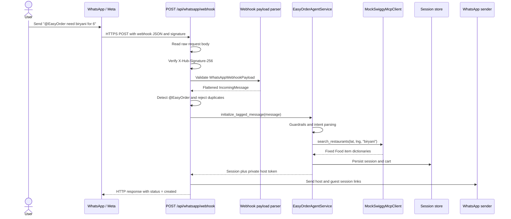
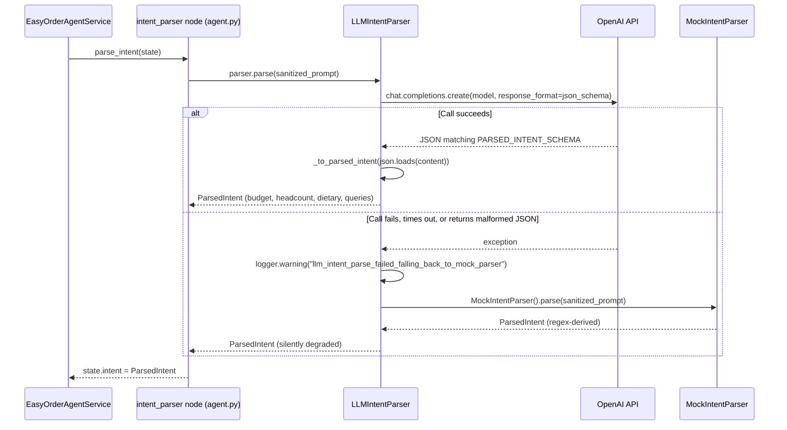
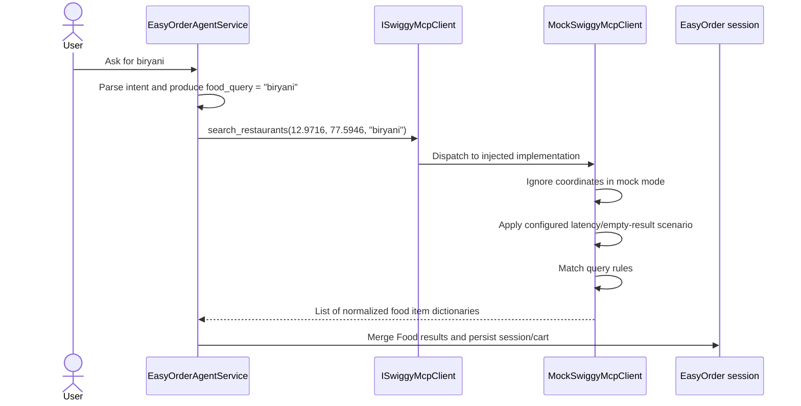
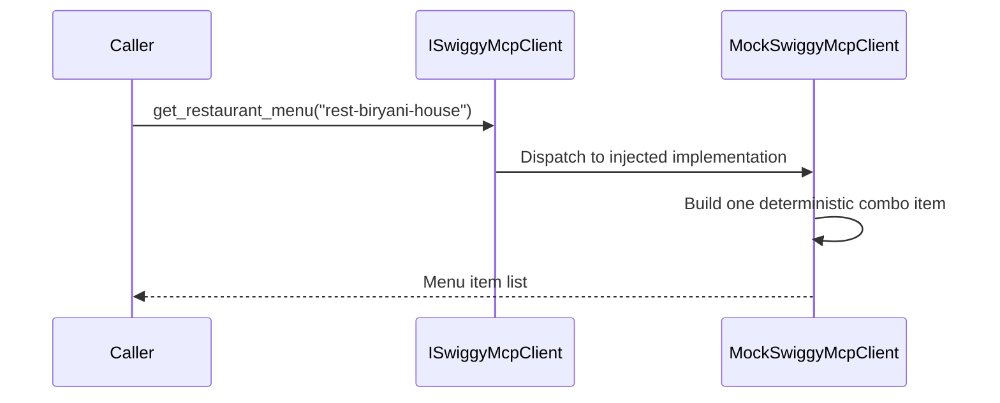
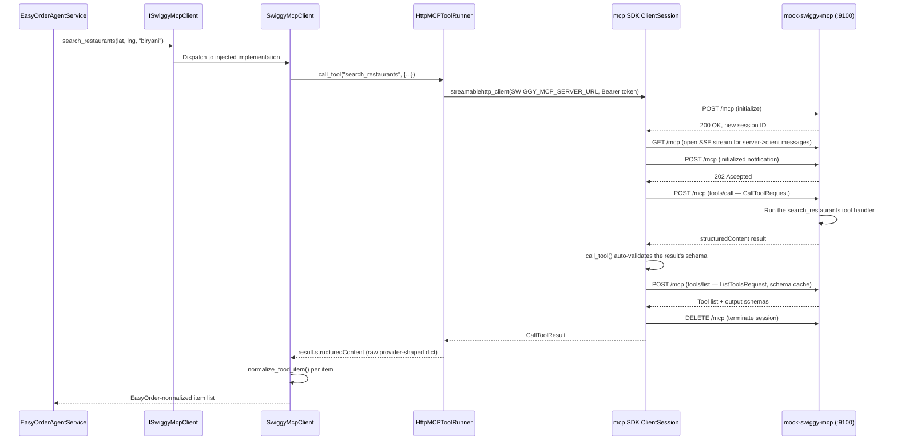

# Mock Swiggy Restaurant Call Flow

## Purpose

This document explains how EasyOrder gets restaurant/Instamart information,
covering **both** ways the app can be configured to do that:

1. **In-process mock** (`SWIGGY_CLIENT_MODE=mock`, the default) — an in-process
   Python object, `MockSwiggyMcpClient`. No network calls, no server to run.
2. **Real MCP over HTTP** (`SWIGGY_CLIENT_MODE=mcp`) — the backend acts as a
   real MCP client and talks to a real, separately-running MCP server
   (`services/mock-swiggy-mcp/`, or eventually a real Swiggy-hosted endpoint)
   over the network. This is what produces the `POST/GET/DELETE /mcp` log
   lines you see in the mock server's terminal.

Both implement the same `ISwiggyMcpClient` interface, so the rest of the app
(the agent, the Food/Instamart workers) doesn't know or care which one is
active. It covers two operations: searching with `search_restaurants`, and
fetching a menu with `get_restaurant_menu`.

> **Not to be confused with `LLM_MODE`.** `SWIGGY_CLIENT_MODE` (this doc) and
> `LLM_MODE` are two independent settings that happen to both run inside the
> same agent graph:
> - `LLM_MODE` controls **intent parsing** — turning your WhatsApp text into
>   structured budget/headcount/dietary/query fields (`intent_parser` node).
> - `SWIGGY_CLIENT_MODE` controls **item search** — the very next step
>   (`swiggy_workers` node), which searches Swiggy Food/Instamart for items
>   matching whatever the intent parser produced.
>
> Setting `SWIGGY_CLIENT_MODE=mcp` with `LLM_MODE=mock` (regex parser, no
> OpenAI key needed) is a completely valid, common combination — real item
> search against the mock MCP server, cheap deterministic intent parsing. The
> MCP server logs you see are from the search step; nothing there requires
> `OPENAI_API_KEY` to be set. See `src/backend/app/services/llm_intent.py`
> for the LLM path and `src/backend/app/services/swiggy_mcp.py` for this one.

## Main components

| Component | Responsibility |
| --- | --- |
| `EasyOrderAgentService` | Parses the user's request and invokes the Food/Instamart workers. |
| `MockIntentParser` | In-process regex intent parsing (`LLM_MODE=mock`). Also the automatic fallback if the real LLM call fails. |
| `LLMIntentParser` | Real intent parsing via OpenAI (`LLM_MODE=openai`). See [Real LLM intent parsing flow](#real-llm-intent-parsing-flow-llm_modeopenai) below. |
| `ISwiggyMcpClient` | Defines the operations that both mock and real clients must implement. |
| `MockSwiggyMcpClient` | In-process: selects and returns fixed local results (`SWIGGY_CLIENT_MODE=mock`). |
| `MockSwiggyScenario` | Optionally changes mock behavior, such as latency or empty results. |
| `SwiggyMcpClient` | Real MCP mode: normalizes provider-shaped tool responses into EasyOrder's shape (`SWIGGY_CLIENT_MODE=mcp`). |
| `HttpMCPToolRunner` | Real MCP mode: opens one MCP session per tool call over `SWIGGY_MCP_SERVER_URL`. |
| `services/mock-swiggy-mcp/app/server.py` | A real, independent MCP server (official `mcp` SDK) — what `HttpMCPToolRunner` actually connects to locally. |
| Session persistence | Converts returned dictionaries into cart items and saves the EasyOrder session. |

## How the request reaches the backend

For the WhatsApp path, the user does not call the mock client directly. The
request first travels through Meta's WhatsApp infrastructure and enters the
FastAPI application through a webhook.



### 1. FastAPI registers the webhook route

At application startup, `create_app()` includes the WhatsApp router. That
router has the prefix `/api/whatsapp`, and its ingestion handler is declared as
`POST /webhook`. Together these form:

```http
POST /api/whatsapp/webhook
```

In a real Meta setup, this endpoint must be reachable at a public backend URL.
During local development, that normally means exposing the local FastAPI server
through a tunnel and registering the resulting HTTPS webhook URL with Meta.

The separate `GET /api/whatsapp/webhook` route is only for Meta's initial
webhook subscription challenge. Incoming user messages arrive through the
`POST` route.

### 2. Meta sends the webhook payload

A simplified request body looks like this:

```json
{
  "object": "whatsapp_business_account",
  "entry": [
    {
      "id": "BIZ_ACCOUNT_ID",
      "changes": [
        {
          "field": "messages",
          "value": {
            "messaging_product": "whatsapp",
            "metadata": {
              "display_phone_number": "15551234567",
              "phone_number_id": "PH_ID"
            },
            "contacts": [{ "wa_id": "919988776655" }],
            "messages": [
              {
                "from": "919988776655",
                "id": "wamid.example",
                "timestamp": "1782489000",
                "type": "text",
                "text": {
                  "body": "@EasyOrder need biryani for 6"
                }
              }
            ]
          }
        }
      ]
    }
  ]
}
```

Meta also supplies `X-Hub-Signature-256`. Unless signature verification is
explicitly disabled for local development, the backend calculates an HMAC of
the raw body using `WHATSAPP_APP_SECRET` and rejects missing or invalid
signatures with HTTP `401`.

### 3. The nested payload becomes an internal message

The route validates the JSON as `WhatsAppWebhookPayload`. It then calls
`extract_incoming_messages`, which ignores unsupported/non-text events and
flattens each text message into:

```json
{
  "sender_id": "919988776655",
  "message_id": "wamid.example",
  "message_text": "@EasyOrder need biryani for 6",
  "phone_number_id": "PH_ID",
  "timestamp": "1782489000",
  "is_easyorder_tagged": true
}
```

Tag detection is case-insensitive: the backend checks whether `@easyorder`
appears in the lowercased message text.

### 4. The route decides whether this is a planning request

Tagged messages enter `planning_messages`. An untagged message can also enter
the planning flow when dedicated business-chat routing classifies it as an
intent that creates a session. Other untagged messages may receive a direct
business-chat response, or the webhook is acknowledged as ignored.

Before processing a planning message, the route checks its WhatsApp message ID
in the session event store. This prevents Meta webhook retries from creating a
second EasyOrder session for the same message.

### 5. FastAPI calls the agent service

For a new planning message, the route executes:

```python
result = await agent_service.initialize_tagged_message(message)
```

FastAPI obtains `agent_service` from `request.app.state.agent_service`. That
dependency is created once during application startup based on settings.

The agent graph then runs these stages in order:

```text
input_guardrails
    -> intent_parser
    -> swiggy_workers
    -> output_guardrails
    -> persistence
```

For the example message, the intent parser produces a Food query such as
`"biryani"`. The Food worker then calls `search_restaurants`, which begins Use
Case 1 below.

## Real LLM intent parsing flow (`LLM_MODE=openai`)

The `intent_parser` node (step 5 above) is where `LLM_MODE` matters —
independently of `SWIGGY_CLIENT_MODE`, which only affects the *next* node,
`swiggy_workers` (see the [Real MCP flow](#real-mcp-flow-swiggy_client_modemcp)
section below). `LLM_MODE=mock` (default) uses `MockIntentParser` — pure
regex, no network call. `LLM_MODE=openai` uses `LLMIntentParser`, a real
OpenAI Chat Completions call with a strict JSON schema for structured output.



The fallback means a request **always** succeeds — an OpenAI outage or bad
API key never breaks the WhatsApp flow, it just silently degrades to regex
parsing for that message. That's deliberate (mirrors how `swiggy_workers`
degrades gracefully on a Swiggy timeout), but it also means **"the webhook
returned 200" is not proof the real LLM ran** — see the logging note below.

### How to trigger it manually

There's no standalone "test parsing" endpoint — the only trigger is a real
tagged WhatsApp message (or a signed webhook replay, see
`scripts/replay_whatsapp_webhook.py`), since `intent_parser` only runs during
session creation. If `WHATSAPP_PROVIDER_MODE=meta`, sending a message from a
real phone is the only way to trigger this that doesn't also send a real
outbound WhatsApp message as a side effect of session creation — a signed
webhook replay against a `meta`-mode backend does both. Use a message
specific enough to tell the two parsers apart, e.g.:

```
@EasyOrder get biryani and cold drinks for 6 under 3000, mostly vegetarian
```

A regex parser catches `under 3000` / `for 6` fine but is unlikely to also
resolve "mostly vegetarian" into `dietary_preference=VEG` or cleanly split
"cold drinks" into a separate Instamart query — a correct split in the
resulting cart is your practical signal that real parsing ran.

### Which logs to check

There is currently no explicit **success** log line for the LLM path — only
a **failure** one, so confirmation is partly by absence:

- **Failure signal** (backend terminal): grep for
  `llm_intent_parse_failed_falling_back_to_mock_parser`. Its presence (with a
  traceback, since it's logged with `exc_info=True`) means the real call
  failed and the regex fallback silently took over for that message.
  Its *absence* is your (indirect) confirmation the real call succeeded.
- **Request-level confirmation**: the `request_complete` log line for the
  `POST /api/whatsapp/webhook` request (same structured-log shape as every
  other request) confirms the webhook was received and processed.
- **Content-level confirmation**: open the resulting session and check
  whether the parsed budget/headcount/dietary/cart reflect nuance a regex
  couldn't have caught — the strongest signal, since the logs alone can't
  distinguish "LLM succeeded" from "LLM never ran because nothing failed".

`[TODO: add an explicit success-path log line (e.g. `llm_intent_parse_succeeded`
with the model name) so this doesn't rely on the absence of a warning —
tracked as a follow-up, not yet done.]`

### 6. The backend returns an acknowledgement and sends links

After the agent persists the session, the webhook route creates short host and
guest links. In Meta mode it sends a private session handoff to the original
sender. In mock provider mode it sends a guest message and a private host
message through the mock sender.

The HTTP response to the webhook provider is shaped like:

```json
{
  "status": "created",
  "sessions": [
    {
      "session_id": "<generated-session-id>",
      "guest_link": "<full-guest-link>",
      "guest_short_link": "<short-guest-link>",
      "status": "<session-status>"
    }
  ]
}
```

This HTTP response acknowledges the webhook. The links visible to the user are
sent separately by the configured WhatsApp sender.

## Use case 1: Search for restaurants or dishes

### Example user request

Suppose a user sends a request that the intent parser turns into:

```text
food_query = "biryani"
```

The agent calls the client with EasyOrder's default Bengaluru coordinates:

```python
results = await swiggy_client.search_restaurants(
    lat=12.9716,
    lng=77.5946,
    query="biryani",
)
```

### Call sequence



`ISwiggyMcpClient` is a Python protocol rather than a runtime network hop. The
arrow through the contract shows that the agent depends on the interface; the
actual method executes directly on the injected `MockSwiggyMcpClient` instance.

### How the mock chooses the result

Inside `search_restaurants`, the mock:

1. Accepts `lat`, `lng`, and `query` to match the real client interface.
2. Discards `lat` and `lng`; mock results are not location-sensitive.
3. Waits if `food_latency_seconds` is configured.
4. Returns `[]` if `empty_food=True` is configured.
5. Converts the query to lowercase.
6. Chooses one of three fixed result branches.

| Query contains | Returned branch |
| --- | --- |
| `veg` or `paneer` | Paneer tikka rolls and masala dosa |
| `pizza` | Farmhouse pizza and brownie box |
| Anything else | Chicken biryani and paneer tikka rolls |

Because `"biryani"` does not contain `veg`, `paneer`, or `pizza`, the default
branch is selected.

### Exact returned data

The call returns a Python `list` containing two dictionaries:

```json
[
  {
    "item_id": "food-chicken-biryani",
    "name": "Chicken dum biryani family pack",
    "price": "620.00",
    "dietary_tag": "NON-VEG",
    "vertical": "food",
    "source": "mock_swiggy",
    "restaurant_id": "rest-biryani-house",
    "restaurant_name": "Biryani House"
  },
  {
    "item_id": "food-paneer-roll",
    "name": "Paneer tikka rolls",
    "price": "180.00",
    "dietary_tag": "VEG",
    "vertical": "food",
    "source": "mock_swiggy",
    "restaurant_id": "rest-roll-house",
    "restaurant_name": "Roll House"
  }
]
```

The runtime values for `dietary_tag` and `vertical` are Python enum members.
They serialize to the string values shown above when placed in API/session JSON.

### What “restaurant information” means here

The mock does not return a standalone restaurant object. Each returned dish
carries its source restaurant:

```text
Dish: Chicken dum biryani family pack
  └── restaurant_id: rest-biryani-house
  └── restaurant_name: Biryani House
```

This attribution lets EasyOrder group Food cart items by restaurant during
checkout. The result does not currently include ratings, delivery time,
address, cuisine, images, opening status, or delivery fees.

### Timeout and empty-result behavior

The agent wraps the call in its worker timeout. If mock latency exceeds that
timeout, the agent records a `VERTICAL_TIMEOUT` warning and continues with no
Food results. If the mock is configured with `empty_food=True`, the call
completes normally and returns an empty list; that is not treated as a tool
failure.

## Use case 2: Get a restaurant menu

Once a restaurant ID is known, a caller can request its menu:

```python
menu = await swiggy_client.get_restaurant_menu(
    restaurant_id="rest-biryani-house",
)
```

### Call sequence



### How the result is created

Unlike restaurant search, this method has no query branches or lookup table.
It interpolates the supplied restaurant ID into a single generated menu item:

- Item ID: `<restaurant_id>-combo`
- Item name: `Family meal combo`
- Price: `720.00`
- Restaurant name: `Mock Restaurant <restaurant_id>`

For `rest-biryani-house`, the exact result is:

```json
[
  {
    "item_id": "rest-biryani-house-combo",
    "name": "Family meal combo",
    "price": "720.00",
    "dietary_tag": "ANY",
    "vertical": "food",
    "source": "mock_swiggy",
    "restaurant_id": "rest-biryani-house",
    "restaurant_name": "Mock Restaurant rest-biryani-house"
  }
]
```

The method does not verify that the restaurant ID came from
`search_restaurants`. Any string produces one synthetic menu item. For example,
`get_restaurant_menu("unknown")` returns an item with ID `unknown-combo`.

### Current integration status

`get_restaurant_menu` is part of the shared Swiggy client contract and is
implemented by both mock and production clients. However, the current
`EasyOrderAgentService` flow calls `search_restaurants` directly and does not
call `get_restaurant_menu` afterward.

A future two-step discovery flow could be:

```text
search_restaurants("biryani")
    -> select restaurant_id = "rest-biryani-house"
    -> get_restaurant_menu("rest-biryani-house")
    -> show or rank menu items
```

That flow would require application orchestration to be added; the client
method itself is already available.

## Real MCP flow (`SWIGGY_CLIENT_MODE=mcp`)

When `SWIGGY_CLIENT_MODE=mcp`, `create_swiggy_client()`
(`src/backend/app/services/swiggy_mcp.py`) builds a `SwiggyMcpClient` wrapping
an `HttpMCPToolRunner` instead of `MockSwiggyMcpClient`. The agent's
`search_restaurants`/`search_instamart` calls are identical Python calls —
only what's behind `ISwiggyMcpClient` changed.



A few things worth calling out explicitly, since they're easy to miss reading
the logs alone:

- **One MCP session per tool call, not a persistent connection.** Every
  `search_restaurants`/`search_instamart` call opens a fresh session
  (`initialize` → ... → `DELETE`) and tears it down immediately after. If your
  message triggers both a food and an Instamart search, they run concurrently
  (`asyncio.gather` in `agent.py`'s `run_workers`) — that's why you'll see two
  different session IDs in the mock server's log for one WhatsApp message.
- **The paired `ListToolsRequest` is not something EasyOrder's code calls.**
  It's the official `mcp` SDK's own `ClientSession.call_tool()` — it
  automatically calls `list_tools()` after a successful call to fetch/cache
  the tool's output schema and validate `structuredContent` against it. See
  `ClientSession._validate_tool_result` in the `mcp` package if you want to
  read it yourself (`python -c "import inspect; from mcp.client.session
  import ClientSession; print(inspect.getsource(ClientSession.call_tool))"`).
- **Auth** is a shared bearer token, not tied to anything external:
  `SWIGGY_MCP_AUTH_TOKEN` (backend) must equal `MOCK_MCP_AUTH_TOKEN` (server).
  A mismatch fails at the transport layer (401), before any MCP message is
  even processed.
- **Response shape.** The server returns *raw provider-shaped* JSON (e.g.
  `id`/`title`/`diet`), matching what a real Swiggy MCP server would send.
  `SwiggyMcpClient`'s `normalize_food_item`/`normalize_instamart_item`
  functions do the shape translation into EasyOrder's canonical item dict —
  the same translation the mock in-process client already does internally.
  This is why the rest of the app (Food/Instamart workers, cart building)
  never needs to know which mode is active.

## Mock flow versus real MCP flow — summary

| | Mock mode (`SWIGGY_CLIENT_MODE=mock`) | Real MCP mode (`SWIGGY_CLIENT_MODE=mcp`) |
| --- | --- | --- |
| Execution | In-process Python method call | Network call to a real MCP server over `SWIGGY_MCP_SERVER_URL` |
| Data source | Fixed dictionaries in `mock_swiggy.py` | Whatever the MCP server returns (`services/mock-swiggy-mcp/`, or a real Swiggy endpoint later) |
| Coordinates | Ignored | Sent to the tool (still ignored by the mock server today) |
| Response shape | Already EasyOrder-normalized | Raw provider shape; normalized client-side by `swiggy_mcp.py` |
| Auth | None | Bearer token (`SWIGGY_MCP_AUTH_TOKEN` / `SWIGGY_MCP_SERVER_URL`) |
| Used by | Test suite, local demo, default dev setup | Anyone who ran `make mock-mcp-up` (or has real Swiggy MCP access) and set `SWIGGY_CLIENT_MODE=mcp` |

## Relevant source files

- `src/backend/app/main.py` — FastAPI startup, service construction, and router registration.
- `src/backend/app/api/whatsapp.py` — webhook verification, ingestion, routing, handoff, and `create_agent_service()` (chooses mock vs real Swiggy/LLM clients from settings).
- `src/backend/app/models/whatsapp.py` — Meta payload validation and message extraction.
- `src/backend/app/services/agent.py` — the agent graph (`input_guardrails → intent_parser → swiggy_workers → output_guardrails → persistence`), Food/Instamart worker calls and timeout handling.
- `src/backend/app/services/llm_intent.py` — `LLM_MODE` intent parsing: `LLMIntentParser`, `PARSED_INTENT_SCHEMA`, the OpenAI call, and the fallback-to-regex logic (independent of `SWIGGY_CLIENT_MODE`; see [Real LLM intent parsing flow](#real-llm-intent-parsing-flow-llm_modeopenai) above).
- `src/backend/app/services/mock_swiggy.py` — in-process mock: deterministic restaurant/Instamart search, menu data, and order lifecycle.
- `src/backend/app/services/protocols.py` — `ISwiggyMcpClient` contract.
- `src/backend/app/services/swiggy_mcp.py` — real MCP client: `SwiggyMcpClient`, `HttpMCPToolRunner`, response normalization, `create_swiggy_client()` factory.
- `services/mock-swiggy-mcp/app/server.py` — the standalone MCP server itself (tool handlers, bearer-token auth).
- `scripts/replay_whatsapp_webhook.py` — signs a fixture with `WHATSAPP_APP_SECRET` and posts it to a running backend; in `meta` provider mode this also sends a real outbound WhatsApp message as a side effect of session creation.
- `src/backend/tests/test_mock_swiggy.py` — mock contract and scenario tests.
- `src/backend/tests/test_swiggy_mcp.py` — real-client normalization tests (fake runner, no network).
- `src/backend/tests/test_swiggy_mcp_live_server.py` — end-to-end test against the actual running mock server.
- `src/backend/tests/test_llm_intent.py` — `LLMIntentParser` mapping, clamping, and fallback-on-failure tests (fake OpenAI client, no network).
