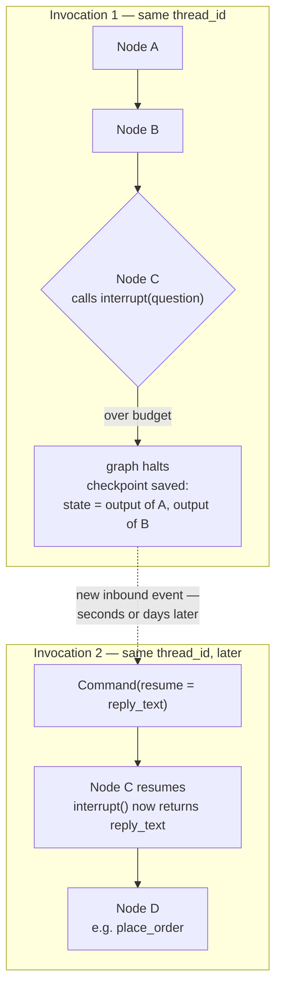
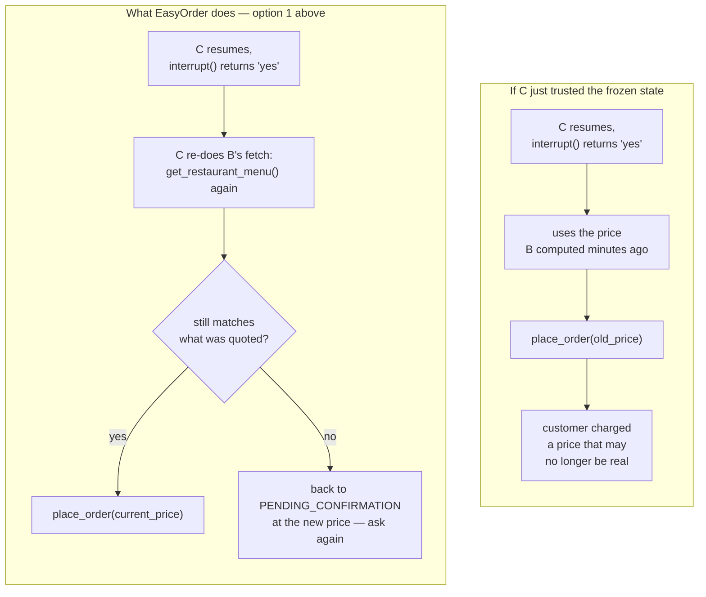

# Pausing for a Human, Mid-Flow

*EasyOrder Engineering Notes*

How an agent "waits" for a person to reply — and what happens to everything
it already knew when it wakes back up. Walked through in LangGraph's own
terms, then in EasyOrder's actual code.

## Contents

1. [The problem: there's no process left to wake up](#1-theres-no-process-left-to-wake-up)
2. [How LangGraph pauses a graph — `interrupt()` and the checkpointer](#2-how-langgraph-does-it-interrupt-and-the-checkpointer)
3. [EasyOrder today: the same idea, built by hand](#3-easyorder-today-the-same-idea-built-by-hand)
4. [Your question: Agent A → B → C, and C needs a human](#4-your-question-a--b--c-and-c-needs-a-human)
5. [What a LangGraph-native rebuild would look like](#5-what-a-langgraph-native-rebuild-would-look-like)
6. [Where Google ADK differs](#6-where-google-adk-differs)

---

## 1. There's no process left to wake up

Every WhatsApp message that reaches EasyOrder is a brand-new, independent
HTTP request into `POST /api/whatsapp/webhook`. It runs, it returns a
response, and the Python process that handled it moves on to the next
request. There is no thread sitting in a loop, no call stack paused at an
`await user_input()`, waiting for your "yes." That call stack was thrown
away the moment the first request finished.

So when we say an agent "pauses to wait for a human," what actually happens
is never a literal pause. It's always the same three-step move, whichever
framework you use:

1. **Write down** everything you'd need to continue, somewhere durable.
2. **Stop.** The process is free to go do other work, or die entirely.
3. **Later, on a new and unrelated request**, look up what you wrote down
   and pick up from there.

```mermaid
sequenceDiagram
    participant U as WhatsApp user
    participant P as A webhook process
    participant S as Durable storage

    U->>P: "order paneer tikka, budget 400"
    P->>S: write down where we got to
    P-->>U: "exceeds budget, reply YES or NO"
    Note over P: response sent. process is free.<br/>nothing is "waiting" in memory.
    rect rgb(50,45,40)
    Note over U,S: any amount of time passes
    end
    U->>P: "yes"   a completely new request,<br/>maybe handled by a different process
    P->>S: read back where we got to
    S-->>P: the saved state
    P->>U: continues from there
```



*The mechanism differs by framework. This shape never does.*

> **The one idea to hold onto**
>
> "Interrupting an agent" is really just naming a checkpoint and a resume
> path. Every framework in this doc — LangGraph, Google ADK, and
> EasyOrder's own hand-rolled version — is a different answer to one
> question: *what exactly gets written down, and what correlates the
> resume back to it?*

---

## 2. How LangGraph does it: `interrupt()` and the checkpointer

LangGraph models an agent as a **graph of nodes** — plain functions —
connected by edges, all reading and writing one shared **state** object.
`EasyOrderAgentService`'s own graph (`input_guardrails → intent_parser →
swiggy_workers → output_guardrails → persistence`) is exactly this shape,
though — important to say up front — it never pauses for a human. It runs
start to finish in one call. The mechanism below is what LangGraph offers
*if* you need a node to stop and wait.

Two pieces make it possible:

- **A checkpointer.** After every node finishes, LangGraph snapshots the
  entire state to a durable store (Postgres, SQLite, or in dev, memory) —
  keyed by a `thread_id` you choose. That snapshot *is* "write down where
  we got to."
- **`interrupt(value)`, called inside a node.** It throws a special signal
  LangGraph catches at the graph level. The graph halts right there — the
  checkpoint from the last completed node is already saved — and `value`
  (your question, e.g. "total is ₹580, exceeds ₹400 — confirm?") is
  returned to whoever called `graph.invoke(...)`, instead of a final
  answer.

To resume, you call the graph again with the **same `thread_id`**, but
instead of a normal input you pass `Command(resume=<the human's answer>)`.
LangGraph loads the checkpoint, re-enters the *exact node that called
`interrupt()`*, and — this is the part people find surprising —
`interrupt()` simply *returns* the human's answer, as if it were an
ordinary function call that happened to take a long time. Everything after
it in that node, and every node after it in the graph, runs normally from
there.



*Nodes A and B do not run again on resume. Their outputs are already in the
checkpoint.*

> **The nuance that matters most**
>
> On resume, LangGraph restores the state **exactly as it was** when
> `interrupt()` fired. It has no idea whether the real world moved on
> underneath that state — a price changed, a dish sold out — because it
> was never told to check. If Node C simply uses the restored state as-is,
> it acts on data that can be stale by however long the human took to
> reply. Getting fresh data on resume is not automatic; you have to design
> for it. That's the exact problem Part 4 walks through.

---

## 3. EasyOrder today: the same idea, built by hand

EasyOrder does **not** use LangGraph's checkpointer or `interrupt()`
anywhere — not even in the pre-existing group-session graph, which is
single-shot and never pauses. The new targeted-order flow needed a real
pause-and-resume, so it was built from the same three-step idea in Part 1,
entirely by hand:

| LangGraph concept          | EasyOrder's hand-rolled equivalent |
|-----------------------------|-------------------------------------|
| Checkpoint                  | One row in the `orders` table, `status = PENDING_CONFIRMATION` |
| `thread_id`                 | The WhatsApp `wa_id` (one pending order per user, enforced by a DB unique index) |
| `interrupt(question)`       | Just... returning the reply text and ending the HTTP request. No signal to catch — the function returns normally. |
| `Command(resume=answer)`    | The next inbound WhatsApp message, checked against `get_pending_confirmation_order(wa_id)` before anything else |

Walked through with the real function names:

```mermaid
sequenceDiagram
    participant U as WhatsApp user
    participant WH as api/whatsapp.py
    participant TOS as TargetedOrderService
    participant SW as SwiggyMcpClient
    participant DB as orders table

    U->>WH: "paneer tikka + chicken 65 from MotiMahal,<br/>budget 400"
    WH->>TOS: handle_targeted_order_message(message)
    TOS->>SW: find_restaurant_by_name("MotiMahal")
    SW-->>TOS: restaurant
    TOS->>SW: get_restaurant_menu(restaurant_id)
    SW-->>TOS: menu — chicken 65 costs 320.00
    TOS->>TOS: total 580.00 exceeds budget 400
    TOS->>DB: create_order(PENDING_CONFIRMATION, total=580.00)
    TOS-->>WH: reply text
    WH-->>U: "exceeds your budget — reply YES or NO"
    Note over WH,DB: request ends. the Order row is the entire<br/>memory of this conversation now.

    rect rgb(50,45,40)
    Note over U,DB: any amount of time passes
    end

    U->>WH: "yes"   a brand new webhook request
    WH->>DB: get_pending_confirmation_order(wa_id)
    DB-->>WH: the PENDING_CONFIRMATION row
    WH->>WH: resolve_pending_order_confirmation(order, "yes")
    WH->>SW: reverify_order_before_placement:<br/>get_restaurant_menu(restaurant_id) again
    SW-->>WH: current menu, current prices
    alt price and items unchanged
        WH->>SW: place_order(items)
        WH->>DB: set_order_placed(...)
        WH-->>U: "Placed!"
    else price changed, or item gone
        WH->>DB: set_order_price_changed(...) or CANCELLED
        WH-->>U: "now costs INR X — reply YES or NO" / "cancelled"
    end
```



*Every box here is a real function in the repo — nothing simplified away.*

### What `reverify_order_before_placement` actually does

This is the piece you flagged not fully following, so — line by line, not
just "trust me":

```python
# src/backend/app/services/targeted_order.py

async def reverify_order_before_placement(swiggy_client, order):
    # 1. Ask Swiggy for the menu AGAIN — not the copy saved on the order.
    menu = await swiggy_client.get_restaurant_menu(order.restaurant_id)
    menu_by_id = {item["item_id"]: item for item in menu}

    # 2. Walk the items that were quoted originally, one by one.
    fresh_items, missing = [], []
    for line in order.items:
        current = menu_by_id.get(line.item_id)
        if current is None:
            missing.append(line.name)          # it's gone from the menu
        else:
            fresh_items.append(OrderLineItem(price=current["price"], ...))  # TODAY's price

    # 3. Re-total from the fresh prices, then compare to what was quoted.
    total = sum(item.price * item.quantity for item in fresh_items)
    unchanged = (not missing) and (total == order.total)
    return ReverificationResult(unchanged, fresh_items, total, missing)
```

It is **not** a smart or LLM-driven check. It's a plain re-fetch-and-diff:
call the same tool the order was originally quoted from, and compare the
answer to what's stored. Two callers use it right before the point of no
return:

- `order_confirmation._place` — right after a "yes" reply, before calling
  `place_order`.
- `order_scheduler._place_one` — right before the scheduler auto-places a
  timed order, since that gap can be an hour or more.

If it comes back `unchanged=False`, `handle_reverification_mismatch` does
one of two things — and never places the order:

> **Item disappeared from the menu**
> Nothing to re-confirm. `update_order_status(CANCELLED)`, tell the user
> which dish is gone.

> **Price changed**
> `set_order_price_changed(...)` moves the order back to
> `PENDING_CONFIRMATION` at the new price and total — the *exact same row,
> same mechanism* as the original budget gate — and asks again. No new
> state machine was invented for this; it reuses the one that already
> existed.

---

## 4. Your question: A → B → C, and C needs a human

Mapped onto EasyOrder's own flow: **Agent A** parses intent (dish names,
restaurant, budget). **Agent B** resolves the restaurant and menu, and
computes a price. **Agent C** is the one that has to stop and ask a human,
then eventually commit.

Your question, precisely: when C finally gets its answer and the chain
continues — does it run with A and B's *original* output, or does it
somehow get *fresh* output from A and B first?

**In LangGraph, by default: the original.** Resuming a checkpoint restores
exactly the state that existed when `interrupt()` fired. A and B are not
re-invoked — there's no mechanism that decides "some time has passed,
maybe I should re-run upstream nodes." If C needs fresh input from what A
or B computed, that has to be an explicit step, in one of two shapes:

1. **C re-does part of B's job itself**, right after `interrupt()`
   returns — the smallest possible fix, and exactly what
   `reverify_order_before_placement` is.
2. **The graph routes back to B** with a conditional edge before reaching
   C again, so B properly re-runs as a node — the "do it as a graph, not a
   patch" version of the same fix.



*The graph engine gives you correct replay for free. It does not give you
correct freshness for free — that's still your job, every time.*

> **Same lesson, multi-agent version**
>
> Nothing about this changes with more agents in the chain
> (A → B → C → D → E). Whichever node calls `interrupt()` is the one that
> resumes with the reply. Everything upstream of it is frozen at whatever
> it was when the interrupt fired, full stop. If any downstream node's
> correctness depends on upstream data staying fresh across the wait, that
> node — or an explicit loop-back edge — has to go get it again. The
> framework will never infer that for you.

---

## 5. What a LangGraph-native rebuild would look like

EasyOrder's version works, and it's arguably simpler to read than a graph
framework for a two-step flow. But if this grows another two or three
steps (say: loyalty-points check, delivery-partner assignment, fraud
screen), a real graph starts paying for itself — replay, persistence, and
multi-node interrupts come for free instead of being re-invented per flow.
Here's the shape it would take:

```python
# sketch — not in the repo

graph = StateGraph(OrderState)
graph.add_node("parse_intent", parse_intent)          # Agent A
graph.add_node("resolve_menu", resolve_menu)          # Agent B
graph.add_node("budget_gate", budget_gate)            # Agent C
graph.add_node("place_order", place_order)

def budget_gate(state):
    if state.total <= state.budget_limit:
        return state
    reply = interrupt({"question": f"Total {state.total}, exceeds budget. Confirm?"})
    if reply != "yes":
        raise OrderCancelled()
    # explicit re-fetch on resume — same lesson as Part 4
    state.menu = swiggy_client.get_restaurant_menu(state.restaurant_id)
    return state

app = graph.compile(checkpointer=PostgresSaver(...))

# first webhook
app.invoke(order_input, config={"configurable": {"thread_id": wa_id}})

# second webhook, whenever "yes" arrives
app.invoke(Command(resume="yes"), config={"configurable": {"thread_id": wa_id}})
```

Note the re-fetch line is still there, by hand, inside `budget_gate` — the
framework changes *who manages the pause*, not whether you have to think
about staleness. That part never goes away.

---

## 6. Where Google ADK differs

ADK's human-in-the-loop shape is conceptually the same three-step move
from Part 1, but the unit that pauses is different: instead of a graph
node, it's a **tool call**. A `LongRunningFunctionTool` returns a
"pending" result instead of a final one; the agent's turn ends with that
pending call still open. The session — its full event history and state —
is written out via a `SessionService` (backed by a database, not memory).
Later, a new inbound event carrying the human's answer is matched back to
that same session id, and the pending tool call is resolved with a
follow-up response, letting the agent continue.

> **Confidence note**
>
> This is the general shape ADK documents for confirmation-style tools; if
> you're actually building on ADK, verify the exact API surface against
> current docs before relying on the names above — this project uses
> LangGraph, not ADK, so this section is comparative context rather than
> something exercised in this codebase.

| Framework | Unit that pauses | What's persisted | Resume trigger |
|---|---|---|---|
| LangGraph | A graph node, via `interrupt()` | Full state, snapshotted by the checkpointer after every node | `Command(resume=...)` against the same `thread_id` |
| Google ADK | A tool call, via `LongRunningFunctionTool` | The session's event history, via `SessionService` | A new event carrying the tool response, against the same session id |
| EasyOrder (this repo) | A plain async function returning early | One row in `orders`, status `PENDING_CONFIRMATION` | Any inbound WhatsApp message, matched by `wa_id` |

---

*`orders.py` · `order_confirmation.py` · `order_scheduler.py` ·
`targeted_order.py` — `src/backend/app/services`, EasyOrder*
